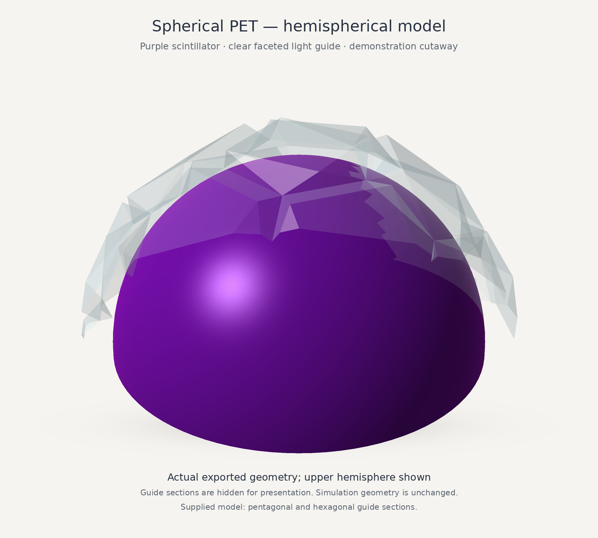

# spherical-pet

A standalone Geant4 application for a spherical LYSO PET detector with a faceted light guide and SiPM arrays. It provides an `eicdirc`-style command line, configuration files, optical-photon transport, CSV output, and offline event displays.



The current simulation constructs a **full sphere**, with **512 SiPMs in 32 arrays of 4 × 4**, and **12 pentagonal plus 20 hexagonal guide sections**. The image shows an upper-hemisphere cutaway for presentation. The supplied geometry does not implement octagonal guide sections. Detector-response parameters are provisional; coincidence selection and PET image reconstruction are not implemented.

## Requirements

- Geant4 **11.1 or newer**, including its physics datasets. Tested here with **11.1.2**; later releases are not yet verified.
- C++17 compiler, CMake ≥ 3.16, and Boost development libraries: `date_time`, `program_options`, `filesystem`, `system`, and `regex`.
- For plots and HTML displays: Python ≥ 3.9 and the packages in `requirements.txt`.
- Optional native GUI: Geant4 built with UI/visualization support, and a graphical display.

G4SiPM and Jansson sources are included under `third_party/`, with their licenses. **No ROOT installation, Git submodules, or private libraries are required.** Both a Git clone and GitHub's source ZIP contain the application dependencies. Geant4, Boost, and Python packages are installed separately.

For Geant4 installation and dataset setup, follow the [official installation guide](https://geant4.web.cern.ch/documentation/pipelines/master/ig_html/InstallationGuide/). On Debian/Ubuntu, the common build tools and Boost headers/libraries can be installed with `sudo apt install build-essential cmake git libboost-all-dev`. That command does not install Geant4.

## Download and build

```bash
git clone https://github.com/mdimran-phy/spherical-pet.git
cd spherical-pet

# If needed, load YOUR Geant4 installation first:
# source /path/to/geant4/bin/geant4.sh

cmake -S . -B build -DCMAKE_BUILD_TYPE=Release
cmake --build build -j4
./build/spherical-pet --help
```

If CMake cannot find Geant4, add `-DGeant4_DIR=/path/to/the/directory/containing/Geant4Config.cmake` or set `CMAKE_PREFIX_PATH` to your installation prefix. Load the environment for the **same Geant4 installation** before running so its libraries and datasets can be found.

The repository contains no site-specific setup paths. The instructions apply equally to an extracted source ZIP.

## Run

Ten single 511 keV gammas from the center, pointing along +z:

```bash
./build/spherical-pet -r 0 -e 10 -x gamma -E 511 \
    -theta 0 -phi 0 -seed 42 -o results/gamma42
```

Check the detector geometry without transporting events:

```bash
./build/spherical-pet -r 1 -o results/geometry
```

Use a configuration file and override selected parameters:

```bash
./build/spherical-pet --config config/default.conf \
    -e 100 --angular isotropic -seed 123 -o results/isotropic123
```

Change the scintillator thickness, optical yield, and decay time:

```bash
./build/spherical-pet -e 10 --shell-thickness-mm 8 \
    --lyso-yield 32 --lyso-decay-ns 41 --check-overlaps 1 \
    -o results/thickness8
```

Record complete paths for the first 20 optical tracks in each event:

```bash
./build/spherical-pet -e 1 --track-photons 20 -o results/tracks
```

`--track-photons` selects the first N optical tracks created in each event. It is a diagnostic sample, not a representative light-collection sample. Full paths can produce large files; the default is zero.

`-E` means **kinetic energy in keV**, unlike `eicdirc`'s momentum option `-p`. `-r 0` means simulation and `-r 1` means geometry inspection; DIRC reconstruction run modes do not apply here. `e-` and `e+` are also supported primary particles. A single gamma is not an annihilation pair; a positron can annihilate through the configured electromagnetic physics.

Output directories must be new. Existing paths are never overwritten. The application supports one `/run/beamOn` per invocation.

## Parameters

`--help` is the complete command-line reference. [docs/parameters.md](docs/parameters.md) lists all options, units, defaults, and aliases. [config/default.conf](config/default.conf) contains all defaults with comments.

Common options:

| Option | Purpose | Default |
|---|---|---|
| `-r`, `--mode` | `0`/`simulation` or `1`/`geometry` | simulation |
| `-e`, `--events` | Primary events | 10 |
| `-o`, `--output` | New output directory | results/run |
| `-seed`, `--seed` | Reproducible random seed | 20261029 |
| `-x`, `--particle` | gamma, e-, or e+ | gamma |
| `-E`, `--energy-kev` | Primary kinetic energy [keV] | 511 |
| `-theta`, `-phi` | Direction [degrees] | 0, 0 |
| `--angular` | fixed or isotropic | fixed |
| `-gx`, `-gy`, `-gz` | Source position [mm] | 0, 0, 0 |
| `--shell-thickness-mm` | LYSO thickness; outer radius stays 34.5 mm | 10 |
| `--sipm-pitch-mm` | Center spacing in each array [mm] | 4.4 |
| `--spectrum` | CSV emission spectrum in photon energy | provisional flat spectrum |
| `--check-overlaps` | Sampled geometry audit before transport | 0 |
| `--track-photons` | Optical tracks saved per event | 0 |
| `-b`, `--batch` | 1=batch, 0=native GUI | 1 |

Configuration files use `key = value`; a line starting with `#` is a comment. Explicit CLI options override configuration files regardless of their position. Multiple configuration files are read in argument order. Input-file paths in a configuration file are relative to that file; the output path is relative to the working directory. Use `--print-config` to inspect the resolved values without running Geant4.

An optional `--macro` accepts **only `/gps/*` source commands**, applied after the CLI source settings. See [macros/isotropic_source.mac](macros/isotropic_source.mac). The effective source command sequence is saved in `source_commands.mac`. A macro cannot start extra runs or change random seeds.

## Output

Each run saves its resolved parameters, actual emission-spectrum table, Geant4/compiler information, and effective source commands. See [docs/output.md](docs/output.md) for schemas and interpretation.

| File | Contents |
|---|---|
| `resolved.conf` | Requested settings after config/CLI precedence |
| `source_commands.mac` | Applied source commands, including macro overrides |
| `spectrum.csv` | Actual scintillation spectrum used |
| `build.txt` | Application, Geant4 and compiler versions |
| `summary.json` | Run totals and optical termination counts |
| `events.csv` | Energy deposition, photons, accepted hits per event |
| `sipm_hits.csv` | Accepted photon IDs, sensor IDs, times and positions |
| `gamma_steps.csv` | Saved gamma trajectory segments |
| `optical_steps.csv` | Optional sampled optical trajectories; header only by default |
| `geometry.obj` | Mesh of actual placed detector volumes, in mm |
| `geometry_inventory.csv` | Placed volumes, materials and sensitive-volume flags |
| `sensor_positions.csv` | Sensitive detector centers in world coordinates |
| `geometry_check.json` | Overlap-check results, when requested |

## Event and detector displays

```bash
python3 -m venv .venv
source .venv/bin/activate
python -m pip install -r requirements.txt

python scripts/plot_results.py --input results/gamma42
python scripts/event_display.py --input results/gamma42 --event 0
python scripts/photo_geometry_display.py --input results/gamma42
```

Open the files under `results/gamma42/figures/`:

- `event_000.png` / `.pdf`: gamma trajectory, SiPM occupancy, and arrival-time histogram.
- `event_display.html`: rotate, zoom, select an event, and filter accepted hits by arrival time.
- `photo_style_detector.png` / `.pdf`: purple scintillator and clear-guide cutaway.
- `photo_style_event_display.html`: shaded 3D model with guide, housing, and event-overlay controls.

The HTML viewers are standalone and need no web server, network connection, or external JavaScript library. The shaded viewer requires WebGL. The displays currently draw gamma paths and SiPM occupancy; recorded optical steps are available in CSV for further analysis. The shaded cutaway can also be generated from a geometry-only output directory.

For the native Geant4 GUI:

```bash
cmake -S . -B build-gui -DCMAKE_BUILD_TYPE=Release -DWITH_GEANT4_UIVIS=ON
cmake --build build-gui -j4
./build-gui/spherical-pet -r 1 -b 0 -o results/native_view
```

This requires a Geant4 installation with suitable UI/visualization drivers and a working graphical display. Headless servers should use the exported HTML viewers.

## Check and install

```bash
ctest --test-dir build --output-on-failure
cmake --install build --prefix "$HOME/.local"
```

Tests cover CLI validation, configuration precedence, deterministic transport, photon accounting, optical-track recording, output protection, and an altered geometry. Lightweight GitHub CI checks the configuration component and Python syntax; the transport suite requires a local Geant4 environment. See [the validation record](docs/validation.md) for the tested environment and actual checks. The installed executable is under `bin/`, and configs, scripts, documentation and licenses are under `share/spherical-pet/`.

## Model scope and development

The 34.5 mm outer scintillator radius, 39.5 mm guide-outlet plane, 18 mm outlet width, 32-array topology, and 4×4 sensors per array remain fixed in the supplied geometry. Supported exposed dimensions are the shell thickness and SiPM pitch; this release does not claim that every historical geometry constant is independently adjustable. Detector construction is in `src/DetectorConstruction.cc`.

Read [docs/physics.md](docs/physics.md) before interpreting light yield or timing. The missing custom sensor was replaced with a documented reference model. Electronics, calibrated material spectra, coincidence processing, and PET reconstruction remain future work.

Contributions should include a small reproducible run, the relevant geometry check, and `ctest` results. Please preserve existing copyright notices. License: **GPL-3.0** for the application and G4SiPM-derived code; Jansson retains its MIT license. See [THIRD_PARTY_NOTICES.md](THIRD_PARTY_NOTICES.md).

Maintainer repository: [mdimran-phy/spherical-pet](https://github.com/mdimran-phy/spherical-pet). Publication instructions are in [docs/publishing.md](docs/publishing.md).
