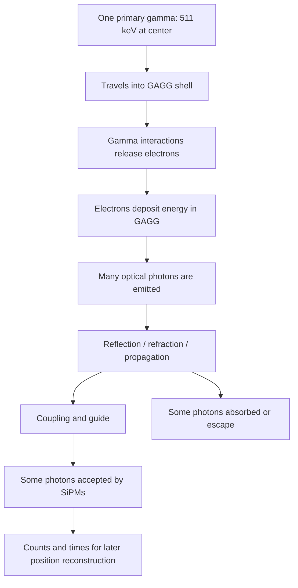

# Understanding the spherical PET event display

Updated 2026-11-15. This guide describes the current GAGG baseline and the
seed-42 event shown in the native viewer. See [model assumptions](ray_baseline.md).

## Detector construction

The detector is a hollow spherical crystal shell, not a solid crystal ball.
From the center outward:

| Component | Current model | Purpose |
|---|---|---|
| Air cavity | Radius 24.5 mm | Contains the point source at (0,0,0); no patient or phantom is present. |
| GAGG scintillator | Radius 24.5–34.5 mm, 10 mm thick | Incoming gamma interactions produce energetic electrons, whose deposited energy generates scintillation light. |
| Optical coupling | Radius 34.5–34.55 mm, 0.05 mm thick | Provisional transparent contact between crystal and light guide. |
| Faceted light guide | 12 pentagonal and 20 hexagonal guide regions; square outlets at 39.5 mm along their normals | Routes and spreads light toward the sensor arrays. This is not a constant-thickness spherical layer. |
| SiPM arrays | 32 arrays × 4×4 sensors = 512 sensors | Record accepted optical photons and their arrival times. |

The source is a mathematical injection point, not an object mounted in the cavity.
The two crystal hemispheres have a 0.1 mm equatorial coupling seam. The inner
crystal surface is ground (rough), the outer surface polished (smooth). Ground
finish does not imply a perfect reflector. The default inner boundary is bare;
exposed guide boundaries are provisionally absorbing. SiPM windows, housings and
an outer mask also exist, although some are hidden for display clarity. The
material parameters and coatings include assumptions, not measured calibration.

## What happens in one event

A primary is the particle explicitly injected at the start. For this run it is
one gamma, not an electron or positron. It starts at the origin, moving along +z.
A gamma photon carries 511 keV = 511,000 eV. The scintillation photons are also
photons, but their energy is about 2.38 eV, near 520 nm visible green light.
The cyan drawing color is a viewer convention, not the physical wavelength.

Compton scattering transfers some gamma energy to an electron and changes the
gamma direction. Photoelectric absorption removes the gamma and releases an
electron; atomic relaxation can also produce secondary photons/electrons.
The electrons lose energy in the crystal and excite it. The crystal subsequently
emits light. Thus the gamma does not simply become one optical photon.

The provisional yield is 57 scintillation photons per deposited keV. A 511 keV
full-energy deposit therefore has a mean yield near 29,127; random fluctuations
change the realized number. The 88 ns decay parameter describes a distribution
of emission delays, not a fixed waiting time for every photon. A small Cherenkov
contribution is also enabled.

## Event, track, step and hit

- Event: one injected primary and all its resulting particles in this run.
- Secondary: a new particle produced during an interaction, such as an electron.
- Track: the history of one particle. Each optical photon has its own track.
- Step: one segment of a track between successive updates/interactions/boundaries.
- Trajectory: the stored path used for drawing a track.
- Hit: here, one optical photon accepted by the sensor filters. It is not a
  reconstructed gamma interaction or a simulated digitized electronic pulse.

One photon can reflect repeatedly, making many line segments while remaining
one track. The display accumulates paths through the event; it is not a snapshot
of all particles simultaneously occupying the shown positions.

## Interpreting the screenshot

Red trajectories are gammas; blue are electrons; cyan are optical photons;
magenta would denote positrons. Green hit markers denote accepted SiPM photons.
Rectangular detector tiles are physical sensor components, not particle tracks.

The displayed log reports 1 event, 511 keV deposited, 29,002 optical photons,
1,099 accepted hits, 100 displayed optical trajectories, 108 total displayed
trajectories, and zero guard kills. Therefore eight displayed trajectories are
non-optical. The 108 is not the number of all simulated particle tracks, and
1,099 is not the number of sensors (there are only 512).

`--vis-photons 100` stores/draws only the first 100 optical tracks created in each
event. All 29,002 optical photons are still simulated. Those first 100 are a
visualization sample, not a statistically representative detector response.
The 1,099 accepted hits use all transported photons, so they can exceed the
number of displayed photon paths.

The matching saved reference event has 28,983 scintillation photons and 19
Cherenkov photons. Its primary gamma undergoes four Compton scatters, one Rayleigh
scatter (direction changes without energy loss), and then photoelectric absorption.
Its first interaction is at (0,0,30.816) mm, inside the GAGG. This event therefore
has several light-production locations. The saved reference event records hits
on 303 distinct sensors.

Some apparent path crossings are projection effects. In addition, the bare
inner boundary permits photons to enter the air cavity and potentially reach
another part of the shell. A cyan line crossing the cavity is not automatically
a geometry error. Photons may be lost by bulk/surface absorption, escaping, or
sensor rejection. The approximately 3.8% accepted fraction in this one event is
an optical collection/acceptance result, not PET scanner sensitivity.

## Why this helps PET development

In PET, positron annihilation produces two gamma photons traveling approximately
in opposite directions. The current simulation starts directly with one 511 keV
gamma to study the detector response. It does not yet simulate coincidence PET
imaging or reconstruct a patient image.

Later, the pattern of 512 sensor counts will be used to estimate where the gamma
interacted in GAGG. The simulation supplies known positions for CNN training.
The desired first interaction can be hard to identify when light comes from
several gamma interactions, as in this event.

For a less cluttered native display, use `--vis-photons 5`; use zero to show
only non-optical trajectories and hit markers. Geometry-only mode is `-r 1`.
These settings change drawing, not the number of optical photons transported
in simulation mode. Use a new output directory each invocation.

## References

- [Geant4 optical and scintillation processes](https://geant4.web.cern.ch/documentation/dev/bfad_html/ForApplicationDevelopers/TrackingAndPhysics/physicsProcess.html).
- [Geant4 tracking](https://geant4.web.cern.ch/documentation/dev/bfad_html/ForApplicationDevelopers/TrackingAndPhysics/tracking.html).
- [Geant4 Compton scattering](https://geant4.web.cern.ch/documentation/pipelines/master/prm_html/PhysicsReferenceManual/electromagnetic/gamma_incident/compton/compton.html).
- [Geant4 photoelectric effect](https://geant4.web.cern.ch/documentation/pipelines/master/prm_html/PhysicsReferenceManual/electromagnetic/gamma_incident/photoelectric/photoelec.html).
- [NIBIB explanation of PET](https://www.nibib.nih.gov/science-education/glossary/p).
- Local evidence: `results/ray_baseline_20261113/events.csv`,
  `gamma_interactions.csv`, `sipm_hits.csv`, `source_commands.mac` and
  the native-display log in the user's screenshot.
