# Spherical PET: a complete beginner course

112 slides • current GAGG model • source snapshot 2026-11-15

Read the idea, inspect the figure, then follow the code. Actual source excerpts are copied from the snapshot; teaching Python illustrates a concept and is not the transport engine. Future pseudocode describes unimplemented work. The native screenshots reproduce event 0 with seed 42.

## Course map

- 01 / START HERE: 6 slides
- 02 / THE BASIC LANGUAGE: 9 slides
- 03 / BUILD THE DETECTOR: 18 slides
- 04 / FOLLOW ONE GAMMA: 14 slides
- 05 / FOLLOW THE LIGHT: 11 slides
- 06 / HOW THE CODE WORKS: 11 slides
- 07 / READ THE REAL EVENT: 15 slides
- 08 / RUN IT YOURSELF: 11 slides
- 09 / FROM MODEL TO EVIDENCE: 9 slides
- 10 / CHECK YOUR UNDERSTANDING: 8 slides

## Slide 001 — A gamma photon becomes a measurable light pattern

**01 / START HERE**

- A complete beginner course for spherical PET.
- Follow one event from source to sensors.
- Every explanation connects to code.

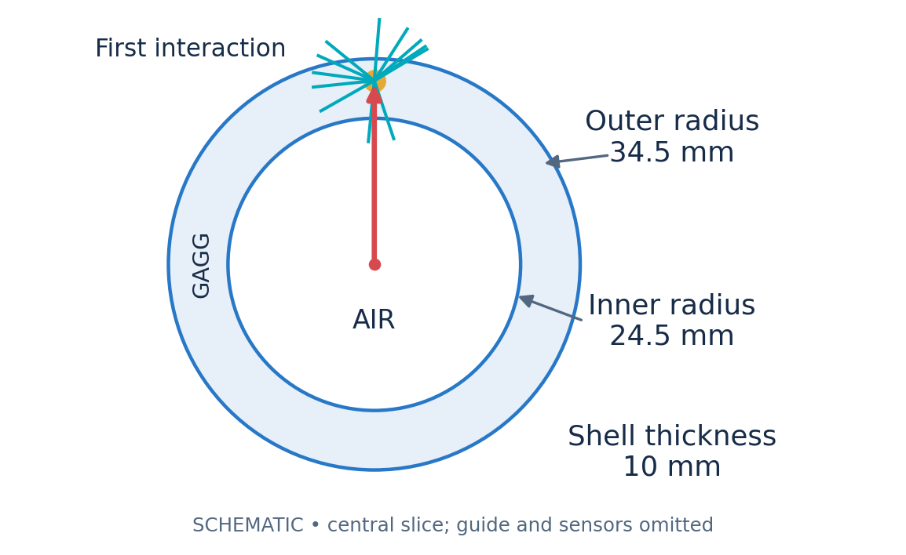

Begin with the picture, not the equations. A high-energy gamma photon enters a crystal shell. Interactions transfer energy to electrons. The crystal emits many visible-light photons, and some reach sensors. We will separate these stages carefully. The course explains the present GAGG model, not a finished clinical scanner. All numbers marked "reference event" come from the saved seed-42 run. Use the speaker notes for definitions and the study guide to copy code. The presentation contains enough material for several lessons; there is no expectation of covering it in one sitting.

**TERMINAL COMMAND** — `Run from the spherical-pet project`

```bash
./build/spherical-pet --help
```

- ./build/spherical-pet starts this application.
- --help lists its supported controls.

Sources: [model: Current baseline and assumptions](../../../docs/ray_baseline.md).

## Slide 002 — How to study this presentation

**01 / START HERE**

- First read the idea and look at the picture.
- Then read the short code example and its meaning.
- Use notes for details; pause at each checkpoint.

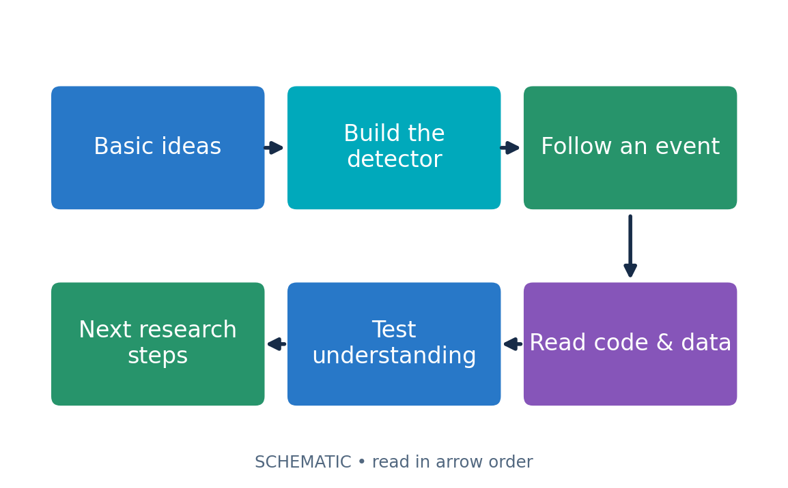

The left side teaches the idea. The right side ties it to a command, a configuration setting, real C++ source, or an explicitly labeled teaching example. Actual source excerpts show a file and line number. Teaching Python is used for arithmetic and simple analogies; it does not replace Geant4. Future pseudocode describes work that has not been implemented. In the HTML viewer, use arrow keys and N for notes. In PowerPoint, notes appear in the notes pane or Presenter View. The study guide includes all notes, code and references.

**TEACHING PYTHON** — `Illustration; not the transport engine`

```python
idea = "one gamma event"
model = "spherical GAGG detector"
result = "sensor counts and times"
print(idea, model, result)
```

- A variable gives a name to information.
- print(...) displays that information.

Sources: [model: Current baseline and assumptions](../../../docs/ray_baseline.md).

## Slide 003 — Four questions guide the whole project

**01 / START HERE**

- Where did the gamma interact in the crystal?
- How much light reaches each sensor?
- How can the pattern help us choose a detector design?

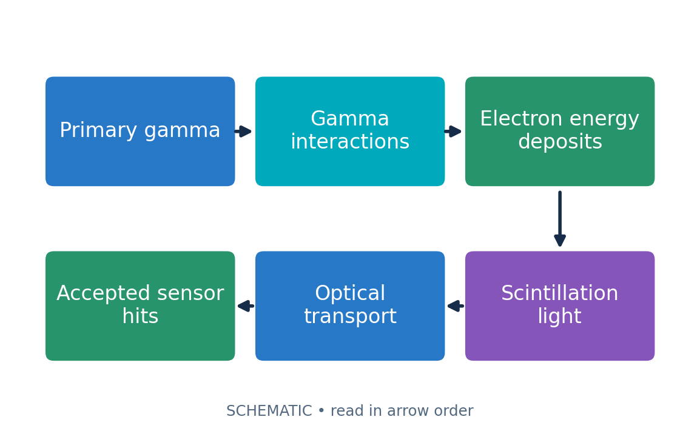

The fourth question, timing, is represented by the arrival times of accepted photons. The immediate task is to validate the geometry and transport so later position reconstruction uses meaningful inputs. A pretty event display is useful for inspection but is not proof of detector accuracy. The eventual goal is to use these simulations to guide a real spherical PET detector design.

**TEACHING PYTHON** — `Illustration; not the transport engine`

```python
questions = ["where?", "how much light?",
             "when?", "which design?"]
for question in questions:
    print(question)
```

- A list holds several related items.
- The loop visits one item at a time.

Sources: [model: Current baseline and assumptions](../../../docs/ray_baseline.md).

## Slide 004 — What PET is trying to measure

**01 / START HERE**

- A radioactive tracer can emit a positron.
- Annihilation can produce two opposing gamma photons.
- Many detected pairs help reconstruct an image.

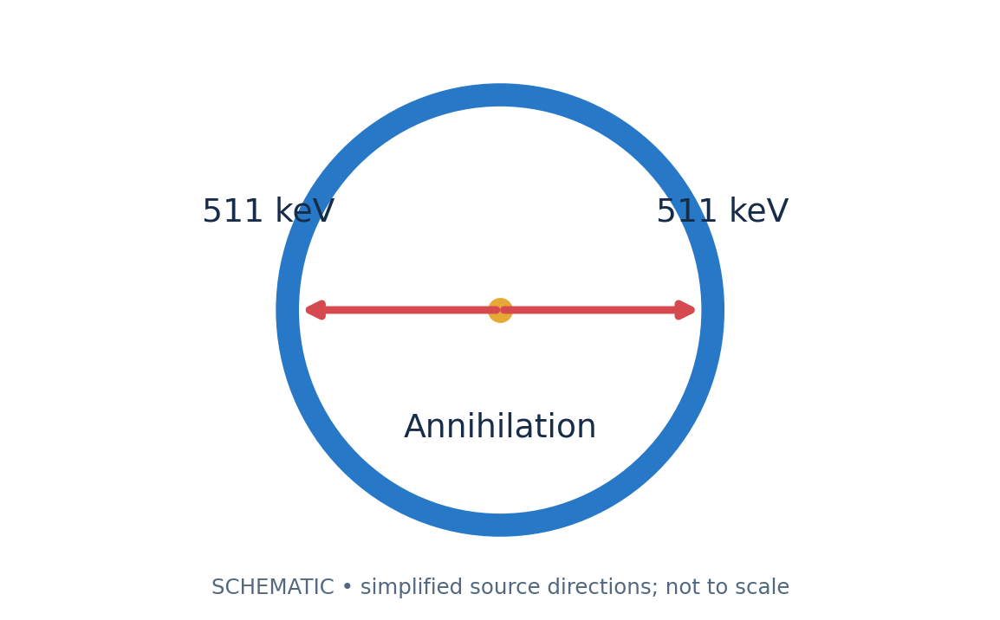

A positron is the electron's positively charged antiparticle. In ordinary PET, its annihilation with an electron gives two approximately opposite gamma photons. The schematic ignores small non-collinearity and positron range. A line between detector interactions does not reveal the exact annihilation point by itself. Image reconstruction combines many events. This is the future scanner context; the current application does not perform coincidence selection or image reconstruction.

**FUTURE / PSEUDOCODE** — `Concept only; not implemented here`

```text
for each detected coincidence:
    locate interaction_A
    locate interaction_B
    add a line between A and B
reconstruct from many lines
```

- A coincidence means two compatible detections.
- Many lines contribute to an image.

Sources: [pet: NIBIB: PET explanation](https://www.nibib.nih.gov/science-education/glossary/p); [model: Current baseline and assumptions](../../../docs/ray_baseline.md).

## Slide 005 — What this simulation does today

**01 / START HERE**

- Inject one 511 keV gamma per event.
- Track interactions, light transport and accepted hits.
- Save data for later reconstruction studies.

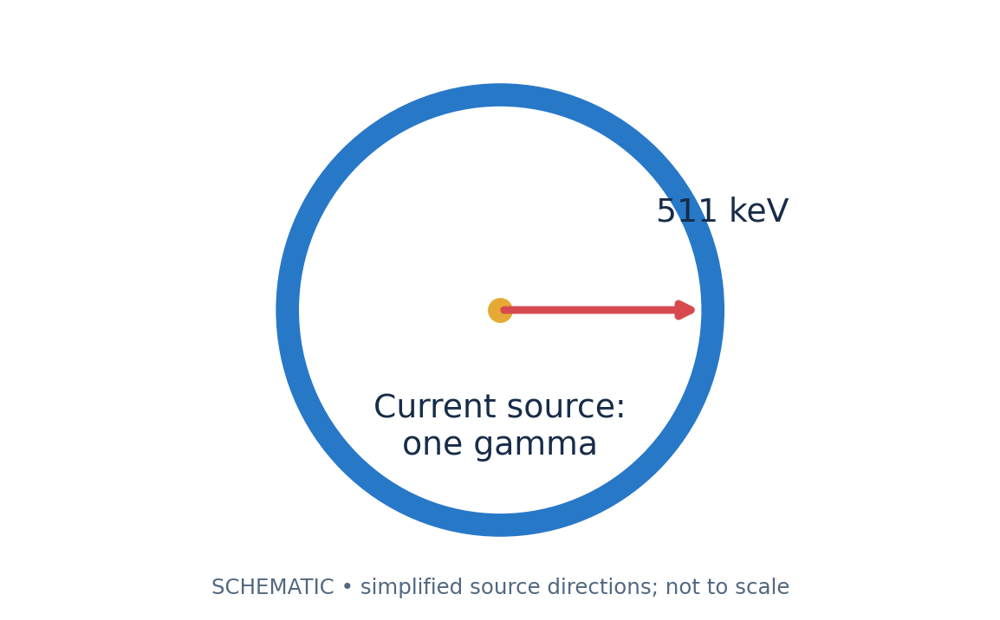

We start directly with a gamma, rather than simulating radioactive decay and a positron source. The default cavity contains air, with no patient or phantom. This choice isolates detector behavior. A single event can still create many secondary particles. The fact that the application is named spherical-pet does not mean it already produces a PET image. Paired photons, electronics and image reconstruction remain later milestones.

**CONFIG EXAMPLE** — `Supported options; values as shown`

```text
particle = gamma
energy-kev = 511
events = 1
angular = fixed
```

- particle and energy-kev define the source.
- events counts independent primary events.

Sources: [model: Current baseline and assumptions](../../../docs/ray_baseline.md).

## Slide 006 — A model is a recipe plus a random experiment

**01 / START HERE**

- Geometry says where materials are.
- Physics says what interactions can happen.
- A random seed makes one software experiment repeatable.

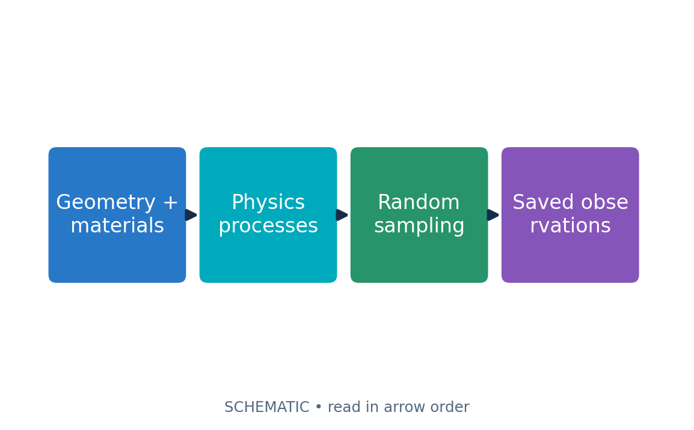

Monte Carlo means using random sampling to model probabilistic events. The physical rules constrain the random choices; the software is not drawing arbitrary pictures. A gamma may travel some distance before interacting, and the scattering angle varies. The same configuration and seed reproduce the same event in the same validated software environment. Different program or library versions may change results, so save configuration and build metadata.

**CONFIG EXAMPLE** — `Supported options; values as shown`

```text
seed = 42
scintillator = GAGG
guide-shape = pentagon-hexagon
```

- 42 selects a reproducible random sequence.
- The other lines choose material and geometry.

Sources: [model: Current baseline and assumptions](../../../docs/ray_baseline.md).

## Slide 007 — An atom contains particles; a photon carries light

**02 / THE BASIC LANGUAGE**

- Electrons are charged particles in matter.
- A photon is a quantum of electromagnetic radiation.
- Gamma radiation and visible light both use photons.

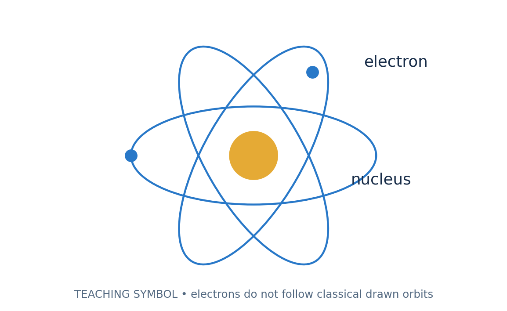

The atom drawing is a teaching symbol, not a model of classical electron orbits or a scale drawing. The nucleus contains protons and neutrons; the surrounding electron distribution is quantum mechanical. We need only the idea that a gamma can transfer energy to an electron in matter. Geant4 distinguishes gamma particles from optical photons so each follows the appropriate physics processes.

**TEACHING PYTHON** — `Illustration; not the transport engine`

```python
particles = ["electron", "gamma",
             "optical photon"]
for name in particles:
    print(name)
```

- The names identify different tracked particle types.
- They have different interaction rules.

Sources: [optics: Geant4 optical processes](https://geant4.web.cern.ch/documentation/dev/bfad_html/ForApplicationDevelopers/TrackingAndPhysics/physicsProcess.html).

## Slide 008 — Energy: eV and keV are measuring units

**02 / THE BASIC LANGUAGE**

- One keV equals 1,000 eV.
- The primary carries 511,000 eV.
- One modeled scintillation photon carries about 2.38 eV.

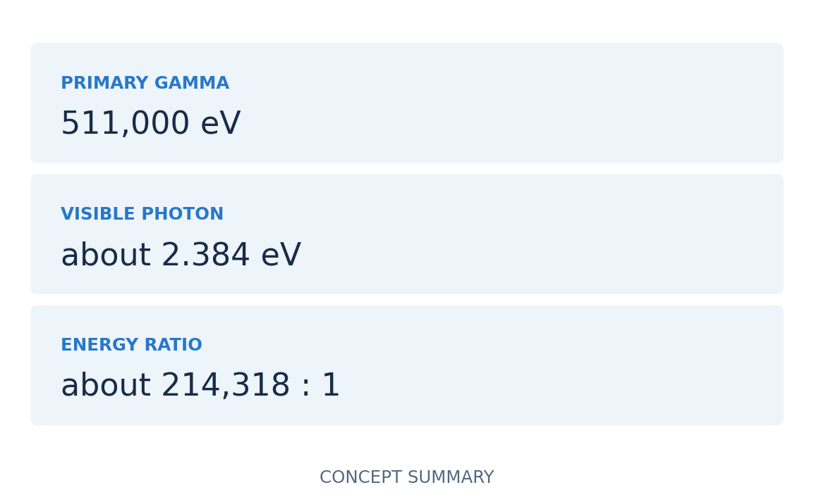

An electronvolt is an energy unit, just as a joule is. We are not using keV as a particle count or a distance. The gamma has over 200,000 times the energy of a single 520 nm optical photon. That ratio is not the light yield: energy conversion is not 100 percent efficient, and the model separately specifies scintillation yield. This code is arithmetic, not a particle-transport calculation.

**TEACHING PYTHON** — `Illustration; not the transport engine`

```python
gamma_eV = 511 * 1000
light_eV = 1239.841984 / 520
ratio = gamma_eV / light_eV
print(gamma_eV, light_eV, ratio)
```

- Multiplication converts keV to eV.
- Division compares the two energy scales.

Sources: [model: Current baseline and assumptions](../../../docs/ray_baseline.md).

## Slide 009 — Wavelength tells us which kind of light

**02 / THE BASIC LANGUAGE**

- Visible wavelengths are measured in nanometers.
- The provisional GAGG peak is around 520 nm.
- Cyan in the viewer is a drawing color.

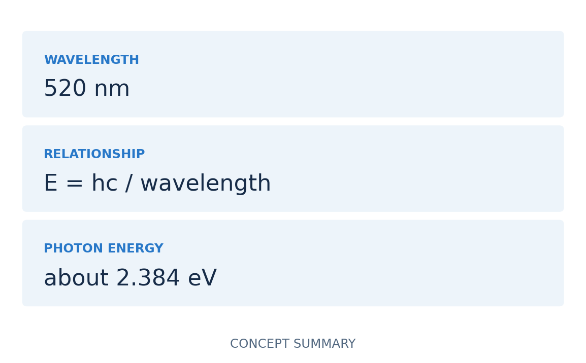

The photon energy–wavelength relationship is E = hc/lambda. The spectrum used here is a narrow flat placeholder near this energy, not a measured GAGG emission curve. The physical light is near green, while the Geant4 visualization draws optical tracks cyan to distinguish them from red gammas and blue electrons. Do not infer photon energy from the line color.

**TEACHING PYTHON** — `Illustration; not the transport engine`

```python
wavelength_nm = 520
energy_eV = 1239.841984 / wavelength_nm
print(round(energy_eV, 3))  # 2.384
```

- The constant represents h times c in eV·nm.
- Shorter wavelength means higher photon energy.

Sources: [model: Current baseline and assumptions](../../../docs/ray_baseline.md); [optics: Geant4 optical processes](https://geant4.web.cern.ch/documentation/dev/bfad_html/ForApplicationDevelopers/TrackingAndPhysics/physicsProcess.html).

## Slide 010 — Millimeters, nanoseconds and the size of the model

**02 / THE BASIC LANGUAGE**

- 10 mm is 1 cm: the crystal shell thickness.
- 0.05 mm is 50 micrometers: assumed radial coupling.
- 1 ns is one billionth of a second.

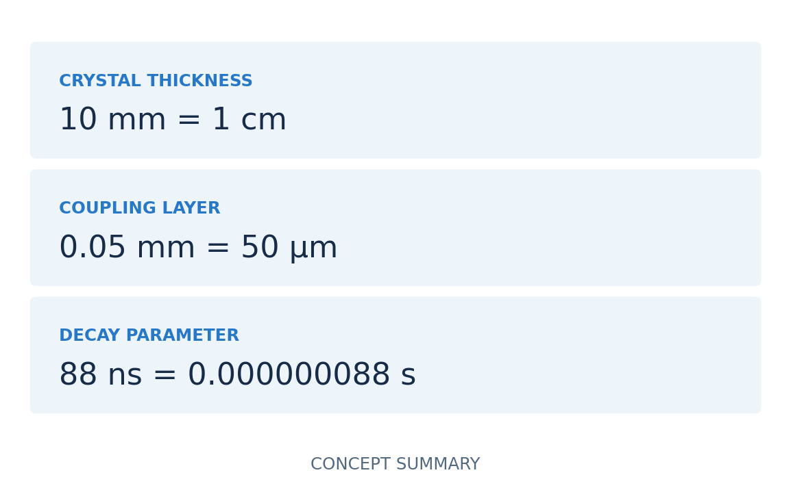

Compare a centimeter with a ruler. The coupling layer is much thinner, so it must be exaggerated in most diagrams to remain visible. The 88 ns value is a provisional scintillation decay parameter; it is a distribution timescale, not the duration of every track. We will mark all exaggerated dimensions. CSV columns name their units to avoid mixing millimeters, energy and time.

**TEACHING PYTHON** — `Illustration; not the transport engine`

```python
shell_cm = 10 / 10
coupling_um = 0.05 * 1000
seconds = 88 * 1e-9
print(shell_cm, coupling_um, seconds)
```

- Unit conversions change the number, not the object.
- 1e-9 means 0.000000001.

Sources: [model: Current baseline and assumptions](../../../docs/ray_baseline.md).

## Slide 011 — Coordinates locate a point in three dimensions

**02 / THE BASIC LANGUAGE**

- The sphere center is (0, 0, 0).
- x, y and z are three perpendicular directions.
- Radius is the distance from the center.

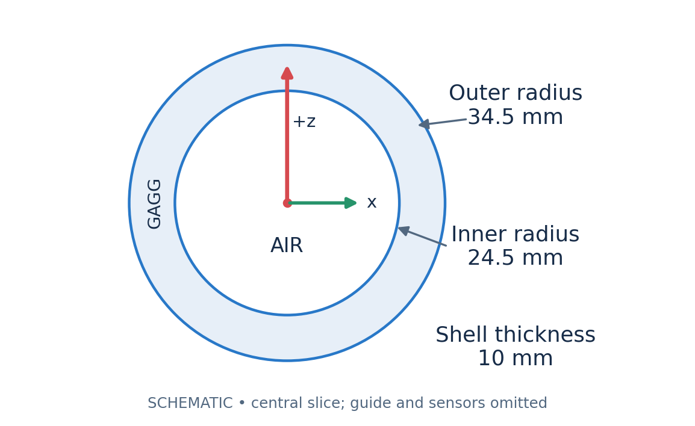

A position needs three numbers. Radius alone does not specify direction: many points lie on the same sphere. Our primary starts at the origin and initially travels along +z. The radius of the first interaction in the reference event is about 30.816 mm, between the inner radius 24.5 mm and outer radius 34.5 mm, so it lies in the scintillator.

**TEACHING PYTHON** — `Illustration; not the transport engine`

```python
x, y, z = 0, 0, 30.816
radius = (x*x + y*y + z*z)**0.5
print(radius)  # millimeters
```

- **0.5 takes a square root.
- This is the 3D distance formula.

Sources: [model: Current baseline and assumptions](../../../docs/ray_baseline.md).

## Slide 012 — Variables, functions and units in C++

**02 / THE BASIC LANGUAGE**

- A variable stores a named value.
- A function performs an action or returns a value.
- Geant4 unit multipliers make dimensions explicit.

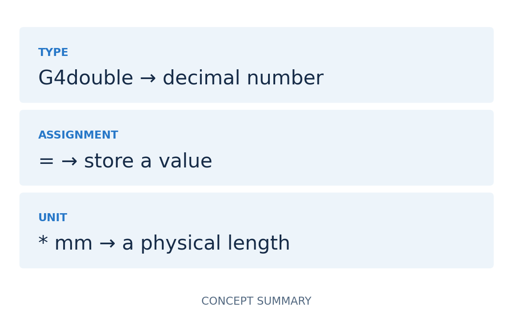

G4double is a floating-point number type. The equals sign assigns a value; it is not a test of equality. The semicolon ends a C++ statement. Multiplying by mm converts our chosen human-readable number to Geant4 internal units. The expression on the third line gives 34.5 mm - 10 mm = 24.5 mm. These are actual lines from the current detector source.

**ACTUAL C++ / CONFIG** — `src/DetectorConstruction.cc:220`

```cpp
G4double hemisphereThickness = config.number("shell-thickness-mm") * mm;
G4double hemisphereRadiusOuterScaled = GeometryParameters::shellOuterRadiusMm * mm;
G4double hemisphereRadiusInner = hemisphereRadiusOuterScaled - hemisphereThickness;
```

- config.number(...) reads a numerical option.
- Outer radius minus thickness gives inner radius.

Sources: [model: Current baseline and assumptions](../../../docs/ray_baseline.md).

## Slide 013 — Conditions and loops make decisions and repetitions

**02 / THE BASIC LANGUAGE**

- An if statement selects what happens next.
- A loop repeats an operation for many items.
- One detector array contains 16 sensors.

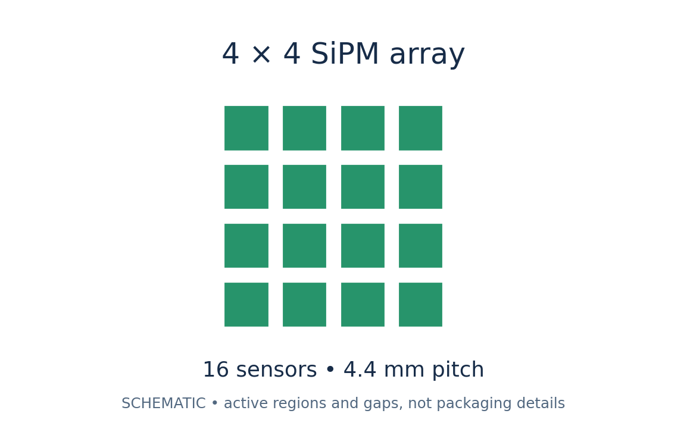

The example demonstrates syntax without pretending to construct Geant4 sensors. Programming often starts counting at zero. In Python, indentation groups statements; in C++, braces usually serve that purpose. Each sensor can have its own counter, position and identifier. Later the application loops over all 512 channels to save a complete event, including channels with zero hits.

**TEACHING PYTHON** — `Illustration; not the transport engine`

```python
for sensor in range(16):
    count = 0
    if sensor == 0:
        print("first sensor")
```

- range(16) visits IDs 0 through 15.
- == compares values; = assigns a value.

Sources: [model: Current baseline and assumptions](../../../docs/ray_baseline.md).

## Slide 014 — Pointers and objects: how to read unfamiliar C++

**02 / THE BASIC LANGUAGE**

- An object bundles data and behavior.
- A pointer refers to an object stored elsewhere.
- The arrow operator calls a method through a pointer.

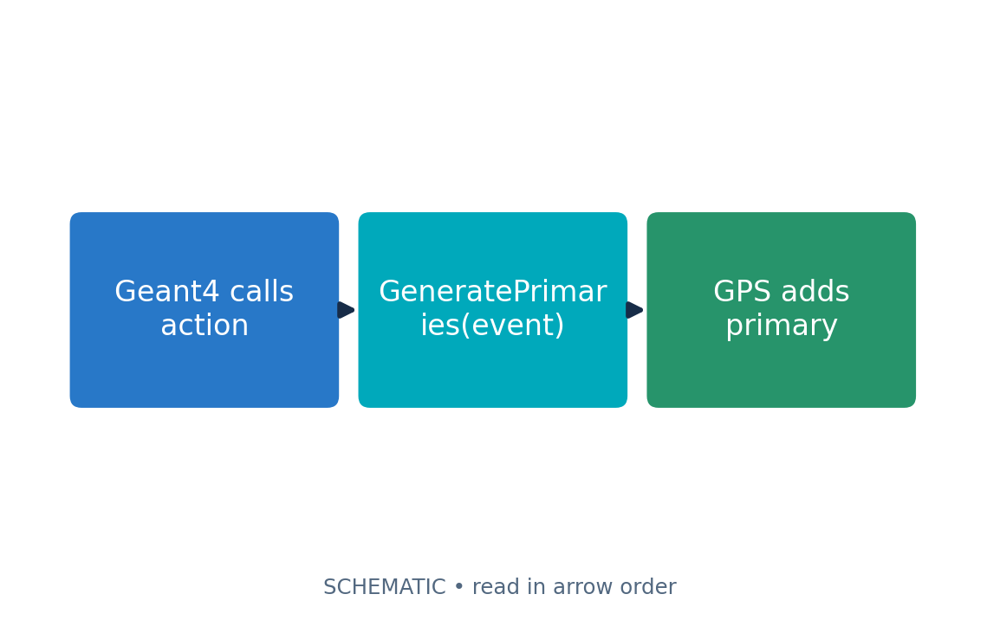

You do not need to master memory management to follow this course. Read G4Event* e as "a reference-like pointer to this event." A method is a function belonging to an object. A dot is used on an ordinary object, while an arrow is used through a pointer. The keyword override tells the compiler this method implements a virtual method from a base class. Geant4 calls the method once for each event.

**ACTUAL C++ / CONFIG** — `src/main.cc:100`

```cpp
void GeneratePrimaries(G4Event* e) override { gps.GeneratePrimaryVertex(e); }
```

- G4Event* e refers to the event being prepared.
- gps.GeneratePrimaryVertex(e) adds the source particle.

Sources: [model: Current baseline and assumptions](../../../docs/ray_baseline.md).

## Slide 015 — A checkpoint before entering the detector

**02 / THE BASIC LANGUAGE**

- A gamma and an optical photon are both photons.
- 511 keV describes energy; 10 mm describes length.
- One primary does not mean only one eventual track.

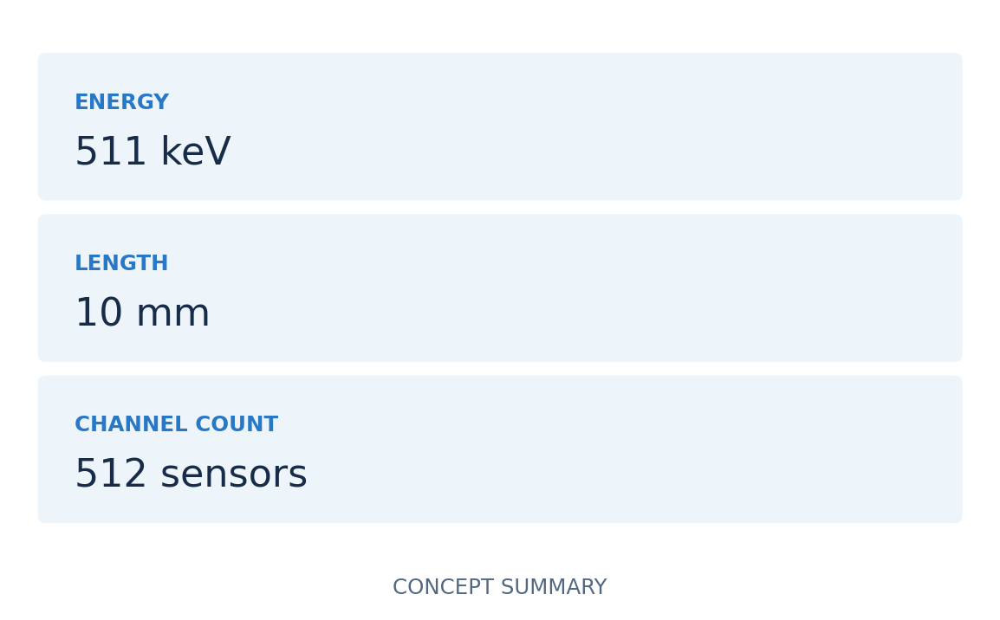

Ask the learner to explain each number before revealing the answer. If they confuse photon count with energy, revisit the energy scale slide. The final calculation connects a local array of 16 sensors to the entire sphere of 32 arrays. All three assertions should pass. An assertion tests a specific property; it does not prove an entire detector model is correct.

**TEACHING PYTHON** — `Illustration; not the transport engine`

```python
assert 511 * 1000 == 511000
assert 34.5 - 10 == 24.5
assert 32 * 16 == 512
```

- assert checks that a statement is true.
- A failed assertion stops a Python script.

**Checkpoint:** Does one 511 keV gamma mean one sensor hit?

**Answer:** No. It may produce many optical photons and many accepted sensor hits, or escape with no signal.

Sources: [model: Current baseline and assumptions](../../../docs/ray_baseline.md).

## Slide 016 — Start with the full detector, then peel back layers

**03 / BUILD THE DETECTOR**

- The transport model covers the full sphere.
- The crystal is a hollow shell around an air cavity.
- Cutaways hide pieces only to help us look inside.

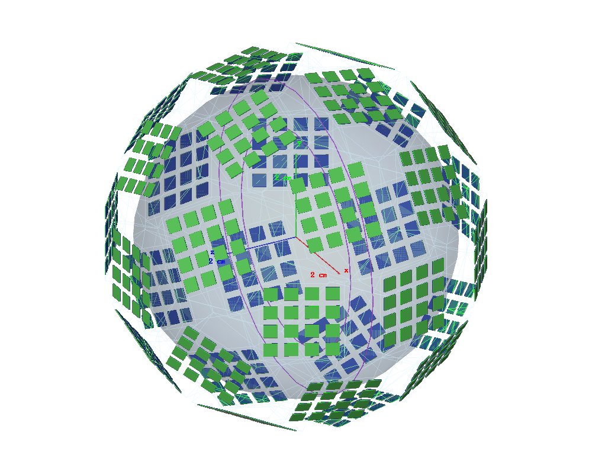

The detector geometry image comes from actual placed Geant4 solids. A presentation cutaway is not a change to the simulation. The application uses two scintillator hemispheres and an equatorial seam. The r=1 mode performs geometry checks. Choose a new output path if this name already exists. A graphical display and a Geant4 visualization-enabled build are needed.

**TERMINAL COMMAND** — `Run from the spherical-pet project`

```bash
./build/spherical-pet -r 1 -b 0 \
    -o results/geometry_lesson
```

- -r 1 inspects geometry without a particle run.
- -b 0 opens the native viewer.

Sources: [model: Current baseline and assumptions](../../../docs/ray_baseline.md).

## Slide 017 — An imaginary slice reveals the hollow shell

**03 / BUILD THE DETECTOR**

- Air fills the center out to radius 24.5 mm.
- GAGG fills the next 10 mm of radial thickness.
- The source starts at the center of the air cavity.


The cross-section is a slice through the sphere center. The ring represents the crystal intersected by that plane. It does not mean the real object is an annulus of finite axial length; the full object is spherical. The cavity diameter is 49 mm and the crystal outer diameter is 69 mm. A single radial line is enough to explain the layer order, but the same order occurs in all directions except for seam and faceted details.

**TEACHING PYTHON** — `Illustration; not the transport engine`

```python
inner_radius_mm = 24.5
outer_radius_mm = 34.5
thickness_mm = outer_radius_mm - inner_radius_mm
print(thickness_mm)
```

- Radius measures center to surface.
- Thickness is the difference between two radii.

Sources: [model: Current baseline and assumptions](../../../docs/ray_baseline.md).

## Slide 018 — Layer 1: a source inside air

**03 / BUILD THE DETECTOR**

- The cavity is an air-filled sphere.
- The source is a mathematical injection point.
- There is no patient or phantom in the baseline.

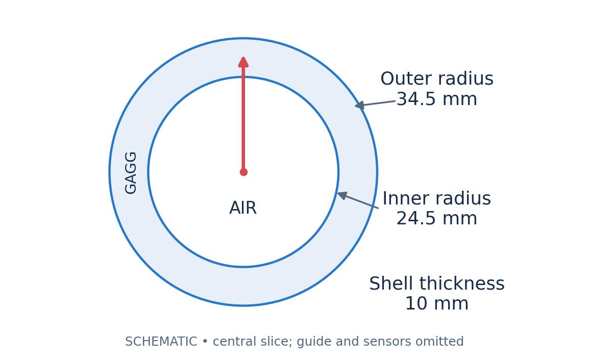

In Geant4 terminology, a solid is a geometric object, not necessarily a physically solid material. Thus a G4Orb can be filled with air. The inner cavity is used to define the inner optical interface consistently in both hemispheres. A primary photon may travel through air; the model still applies appropriate physics there. Do not interpret the central dot as a material capsule or radioactive object.

**ACTUAL C++ / CONFIG** — `src/DetectorConstruction.cc:283`

```cpp
auto* innerCavity = new G4Orb("innerCavity", hemisphereRadiusInner);
auto* innerCavityLV = new G4LogicalVolume(innerCavity,
    MaterialFactory::getInstance()->getAir(), "innerCavity_LV");
innerCavityLV->SetVisAttributes(G4VisAttributes::GetInvisible());
```

- G4Orb creates a solid sphere shape.
- The logical volume assigns air to that shape.

Sources: [model: Current baseline and assumptions](../../../docs/ray_baseline.md).

## Slide 019 — Layer 2: the GAGG crystal

**03 / BUILD THE DETECTOR**

- GAGG is the material that emits scintillation light.
- Its host contains gadolinium, aluminum, gallium and oxygen.
- The current density is 6.63 g/cm³.


The host formula is Gd3Al2Ga3O12. Commercial scintillating GAGG is activated with cerium. This model does not explicitly add a trace Ce mass fraction; its response is represented by the scintillation properties. The listed density and representative optical constants are starting references, not a selected manufacturing specification. The material composition matters for gamma interaction probabilities, while optical properties control emitted-light behavior.

**ACTUAL C++ / CONFIG** — `src/DetectorConstruction.cc:170`

```cpp
scintillator->AddElement(nist->FindOrBuildElement("Gd"), 3);
scintillator->AddElement(nist->FindOrBuildElement("Al"), 2);
scintillator->AddElement(nist->FindOrBuildElement("Ga"), 3);
scintillator->AddElement(nist->FindOrBuildElement("O"), 12);
```

- The integers specify atoms in the host formula.
- 3 Gd + 2 Al + 3 Ga + 12 O form the model.

Sources: [model: Current baseline and assumptions](../../../docs/ray_baseline.md); [gagg: Hilger representative GAGG data](https://www.hilger-crystals.co.uk/wp-content/uploads/2024/12/datasheet-GAGG.pdf).

## Slide 020 — A material has more than a chemical name

**03 / BUILD THE DETECTOR**

- Gamma interactions need composition and density.
- Light transport needs refractive index and absorption.
- Scintillation also needs yield, spectrum and timing.

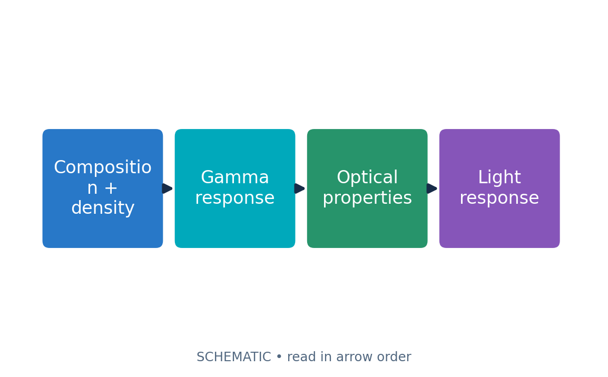

Changing only the label LYSO to GAGG would be inadequate. The implementation changes host chemistry, density and light response. The absorption length has not been measured for the intended crystal. Constant refractive index and absorption are simplifications. Scintillation yield is independent of the probability that a photon later reaches a sensor. These controls allow sensitivity studies but are not a substitute for calibrated material data.

**CONFIG EXAMPLE** — `Supported options; values as shown`

```text
gagg-yield = 57
gagg-decay-ns = 88
gagg-index = 1.9
gagg-absorption-mm = 1000
```

- Yield is photons per deposited keV.
- 1000 mm absorption length is an assumption.

Sources: [model: Current baseline and assumptions](../../../docs/ray_baseline.md).

## Slide 021 — Two hemispheres make the full crystal shell

**03 / BUILD THE DETECTOR**

- North and south crystal pieces are both placed.
- One hemisphere is rotated by 180 degrees.
- A thin equatorial seam separates the pieces.

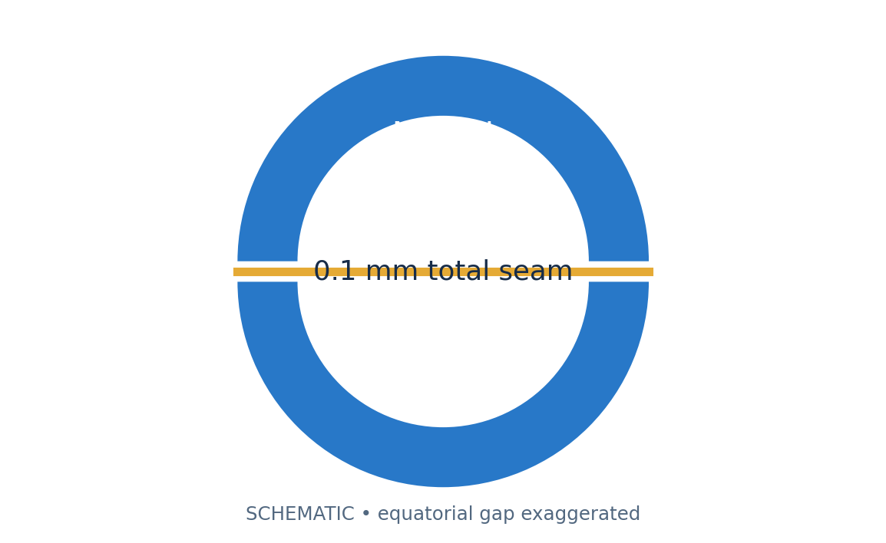

Both hemispheres share the detector center, but their solid definitions occupy different regions. Shared origins do not automatically mean overlapping volumes. Boolean cuts remove a narrow equatorial portion from each scintillator hemisphere and create the gasket pieces. The original total seam thickness is 0.1 mm; each half contributes 0.05 mm. The schematic exaggerates the seam so it can be seen.

**ACTUAL C++ / CONFIG** — `src/DetectorConstruction.cc:265`

```cpp
G4RotationMatrix* rm_x1 = keepRotation(G4RotationMatrix());
rm_x1->rotateX(180.0 * deg);
```

- A rotation matrix changes orientation.
- 180 degrees about x turns a hemisphere over.

Sources: [model: Current baseline and assumptions](../../../docs/ray_baseline.md).

## Slide 022 — Layer 3: a thin optical coupling layer

**03 / BUILD THE DETECTOR**

- A transparent layer connects crystal and guide.
- Its assumed thickness is 0.05 mm.
- It replaces a little guide volume, preserving crystal size.


Think of transparent contact material that joins two optical parts. Its refractive index affects reflection and refraction. The current EncapsoSurrogate uses a silicone-like composition with provisional optical constants. We do not claim these are measured Encapso specifications. A separate sensor-side adhesive thickness is not modeled: the guide currently contacts the reference sensor window directly. The layer in this figure is deliberately enlarged for clarity.

**CONFIG EXAMPLE** — `Supported options; values as shown`

```text
coupling-thickness-mm = 0.05
coupling-index = 1.43
coupling-absorption-mm = 1000
```

- Thickness defines a real modeled volume.
- Index and absorption define its optical behavior.

Sources: [model: Current baseline and assumptions](../../../docs/ray_baseline.md).

## Slide 023 — Layer 4: the faceted light guide

**03 / BUILD THE DETECTOR**

- The guide carries and spreads light toward the arrays.
- Its shape varies around the spherical crystal.
- Square outlets match the sensor-array arrangement.


The guide is not a constant-thickness spherical shell. It has shaped regions that transition toward square outlets. It is constructed as one continuous placed guide solid with faceted regions, not as 32 isolated crystal blocks. Generic guide chemistry and bulk absorption are provisional. The model supports an experimental beveled octagon variant, but Dr. Ray confirmed pentagons and hexagons for this baseline.

**CONFIG EXAMPLE** — `Supported options; values as shown`

```text
guide-shape = pentagon-hexagon
guide-index = 1.5
guide-absorption-mm = 1000
```

- The shape option selects actual transport geometry.
- The guide has its own independent material table.

Sources: [model: Current baseline and assumptions](../../../docs/ray_baseline.md).

## Slide 024 — Why 12 pentagons and 20 hexagons?

**03 / BUILD THE DETECTOR**

- There are 32 guide regions around the sphere.
- Each region connects to one 4 × 4 sensor array.
- This layout resembles the familiar soccer-ball pattern.

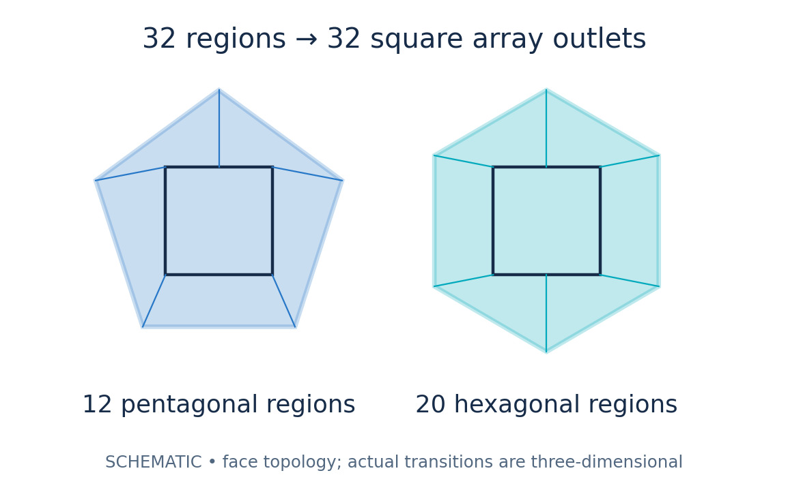

The soccer-ball analogy is about the arrangement of face types; the actual guide outlets and transitions are more complicated. Euler's relation alone does not force exactly 12 pentagons and 20 hexagons for every possible spherical mesh. This particular truncated-icosahedron-style layout is the confirmed design. The total channel count is 12×16 + 20×16 = 512. The crystal itself remains a spherical continuous shell rather than a set of polygonal scintillator blocks.

**ACTUAL C++ / CONFIG** — `include/GeometryParameters.hh:8`

```cpp
inline constexpr int pentagonCount = 12;
inline constexpr int hexagonCount = 20;
inline constexpr int sensorsPerSide = 4;
inline constexpr int sensorsPerArray = sensorsPerSide * sensorsPerSide;
inline constexpr int sensorCount = (pentagonCount + hexagonCount) * sensorsPerArray;
```

- These constants define the topology and array size.
- sensorsPerSide × sensorsPerSide gives 16.

Sources: [model: Current baseline and assumptions](../../../docs/ray_baseline.md).

## Slide 025 — Layer 5: one array contains sixteen SiPMs

**03 / BUILD THE DETECTOR**

- A 4 × 4 grid contains 16 separate sensors.
- Current center-to-center spacing is 4.4 mm.
- The reference sensor active area is about 3 × 3 mm.


The reference sensor replaces an unavailable custom model and is not the final custom array. Active area, package width and pitch are different quantities. The application rejects sensor packages that do not fit the pitch or the 18 mm outlet width. Each sensor produces its own accepted-photon record. Model parameters describe a reference detector, not the intended final Hamamatsu array specification.

**CONFIG EXAMPLE** — `Supported options; values as shown`

```text
sipm-model = HamamatsuS1036233100
sipm-pitch-mm = 4.4
```

- The model name selects a reference sensor.
- Pitch means center-to-center spacing, not width.

Sources: [model: Current baseline and assumptions](../../../docs/ray_baseline.md).

## Slide 026 — One sensor is not the same as one microcell

**03 / BUILD THE DETECTOR**

- Each SiPM contains many tiny light-sensitive cells.
- This reference has 900 cells at 100 micrometer pitch.
- The sphere still has 512 readout sensors.

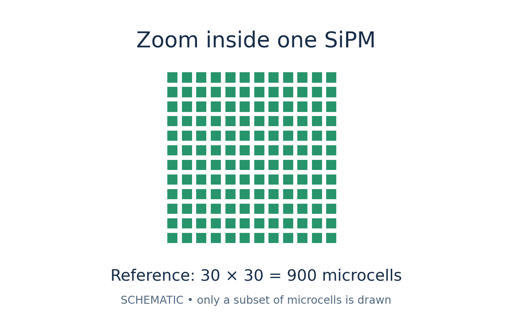

A real SiPM combines many microscopic avalanche elements. A photon-triggered avalanche makes a small electrical pulse. Multiple cells can contribute to a sensor signal. Our application records accepted optical photons and does not invoke electronics digitization, recovery, saturation or noise. The arithmetic count of microcell sites must not be interpreted as 460,800 independent readout channels.

**TEACHING PYTHON** — `Illustration; not the transport engine`

```python
sensors = 512
cells_per_sensor = 900
print(sensors * cells_per_sensor)
# 460800 modeled microcell sites
```

- Multiply two levels of structure to count sites.
- Microcells are not separate output channels here.

Sources: [model: Current baseline and assumptions](../../../docs/ray_baseline.md); [sipm: Hamamatsu: what is an MPPC / SiPM?](https://www.hamamatsu.com/us/en/product/optical-sensors/mppc/what_is_mppc.html); [sipmphysics: Hamamatsu: SiPM operation](https://hub.hamamatsu.com/us/en/technical-notes/mppc-sipms/physics-and-operation-of-the-MPPC-silicon-photomultiplier.html).

## Slide 027 — Polished and ground describe surface texture

**03 / BUILD THE DETECTOR**

- A polished surface is smoother.
- A ground surface has microscopic roughness.
- Roughness changes the directions light can take.

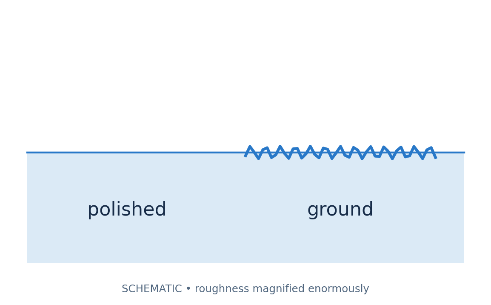

The diagram magnifies microscopic roughness; the real shell is not visibly jagged at this scale. The current inner surface uses ground finish with sigma_alpha = 0.1 rad, while the outer interface is polished. This roughness is provisional. A polished dielectric interface can still reflect; polished does not mean every photon passes through. A ground surface can transmit light; ground does not automatically mean opaque or perfectly reflective.

**ACTUAL C++ / CONFIG** — `src/DetectorConstruction.cc:1000`

```cpp
optical->SetModel(unified);
optical->SetFinish(finish);
optical->SetSigmaAlpha(finish == ground ? config.number("inner-sigma-alpha-rad") : 0);
```

- UNIFIED selects the surface model.
- sigma_alpha controls the modeled microfacet spread.

Sources: [model: Current baseline and assumptions](../../../docs/ray_baseline.md); [optics: Geant4 optical processes](https://geant4.web.cern.ch/documentation/dev/bfad_html/ForApplicationDevelopers/TrackingAndPhysics/physicsProcess.html).

## Slide 028 — Texture and coating are separate choices

**03 / BUILD THE DETECTOR**

- The inner surface is ground and currently bare.
- An optional coating can reflect or absorb light.
- The exposed guide boundary is provisionally absorbing.

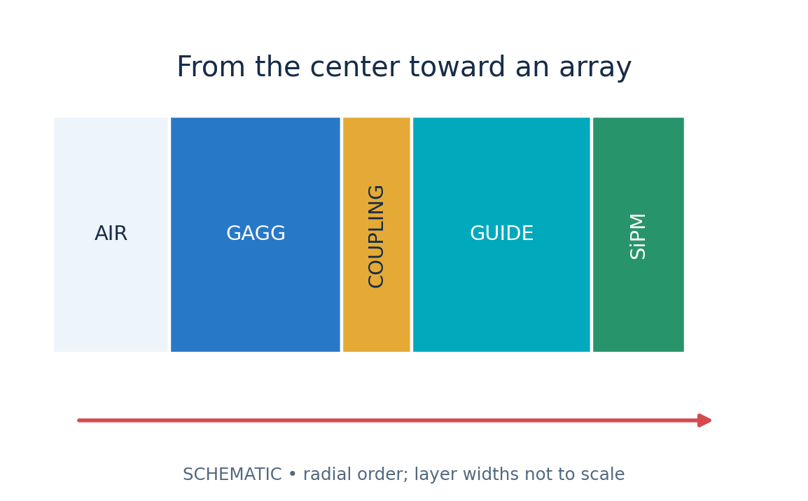

Dr. Ray specified surface finish but did not specify all coatings. We therefore keep these controls visible. The inner cavity is symmetric, removing an older one-sided perfectly reflecting liner. The bare inner boundary allows photons to enter the cavity. Guide absorption is an explicit assumption, not a measurement. A mathematical dielectric_metal boundary is also used to implement idealized coatings; its name does not mean the detector physically contains a newly introduced metal shell.

**CONFIG EXAMPLE** — `Supported options; values as shown`

```text
inner-surface = bare
inner-sigma-alpha-rad = 0.1
guide-boundary = absorber
```

- bare leaves a dielectric optical interface.
- absorber models loss at that boundary.

Sources: [model: Current baseline and assumptions](../../../docs/ray_baseline.md).

## Slide 029 — Two directions require two border definitions

**03 / BUILD THE DETECTOR**

- Light can cross an interface in either direction.
- Geant4 border surfaces are ordered pairs of volumes.
- Both directions are registered in the baseline.

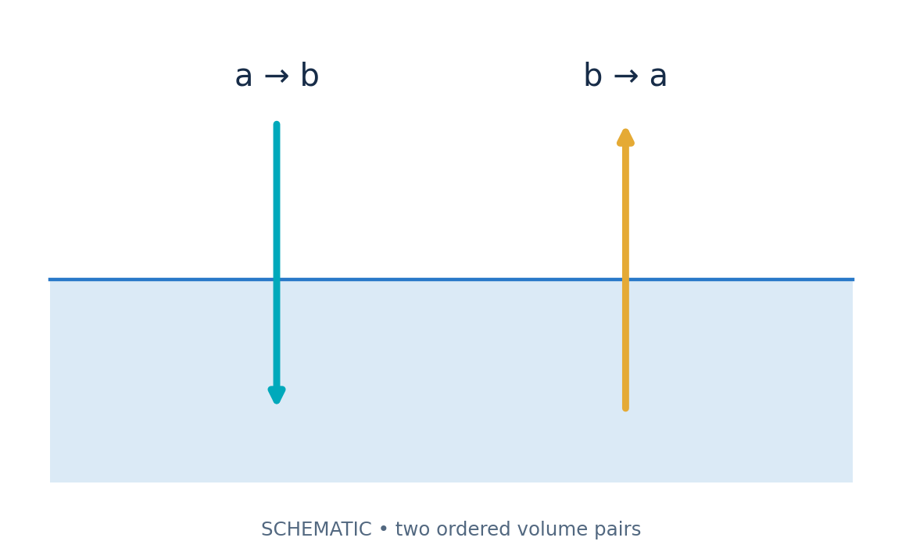

A photon reflected back from a guide can approach a crystal boundary from the opposite side. If only one ordered surface is defined, the reverse crossing may use different default behavior. The implementation adds both directions for the intended interfaces. This is a software-construction issue with a real optical consequence. The figure shows two possible journeys, not two photons necessarily present at the same time.

**ACTUAL C++ / CONFIG** — `src/DetectorConstruction.cc:1021`

```cpp
new G4LogicalBorderSurface(name + "_forward", a, b, optical);
new G4LogicalBorderSurface(name + "_reverse", b, a, optical);
```

- a to b and b to a are different ordered pairs.
- Both share the same selected surface properties.

Sources: [model: Current baseline and assumptions](../../../docs/ray_baseline.md); [optics: Geant4 optical processes](https://geant4.web.cern.ch/documentation/dev/bfad_html/ForApplicationDevelopers/TrackingAndPhysics/physicsProcess.html).

## Slide 030 — Three objects describe one detector part

**03 / BUILD THE DETECTOR**

- Solid: what shape is it?
- Logical volume: what material and properties does it have?
- Physical volume: where is it placed?

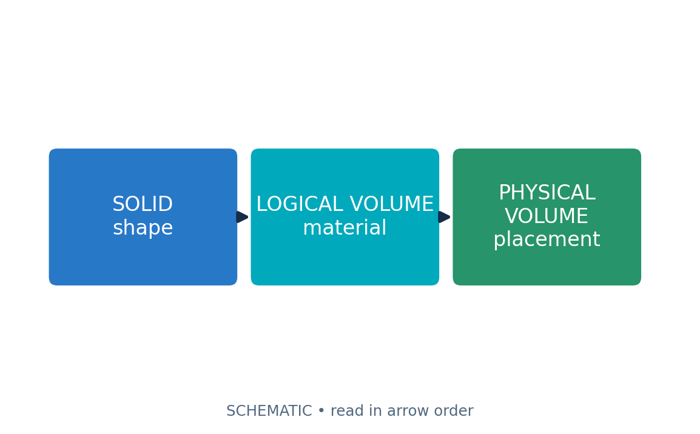

Compare a mold, a chosen material and an assembled location. Geant4 separates these ideas to reuse shapes and materials and to place repeated components efficiently. The same logical volume can sometimes be placed more than once. In this application each reference sensor has its own sensitive detector. The terms solid and logical volume are software concepts rather than descriptions of hardness or intelligent behavior.

**TEACHING PYTHON** — `Illustration; not the transport engine`

```python
solid = "sphere of radius 24.5 mm"
logical = {"shape": solid, "material": "air"}
physical = {"part": logical,
            "position_mm": (0, 0, 0)}
```

- The dictionaries illustrate object relationships.
- This teaching code is not Geant4 construction.

Sources: [geom: Geant4 geometry concepts](https://geant4.web.cern.ch/documentation/pipelines/master/bfad_html/ForApplicationDevelopers/Detector/Geometry/geomIntro.html); [model: Current baseline and assumptions](../../../docs/ray_baseline.md).

## Slide 031 — Boolean geometry: cutting one shape from another

**03 / BUILD THE DETECTOR**

- Subtracting a sphere makes room for the crystal.
- Subtracting a box creates the equatorial seam.
- Many simple operations can build a complex detector.

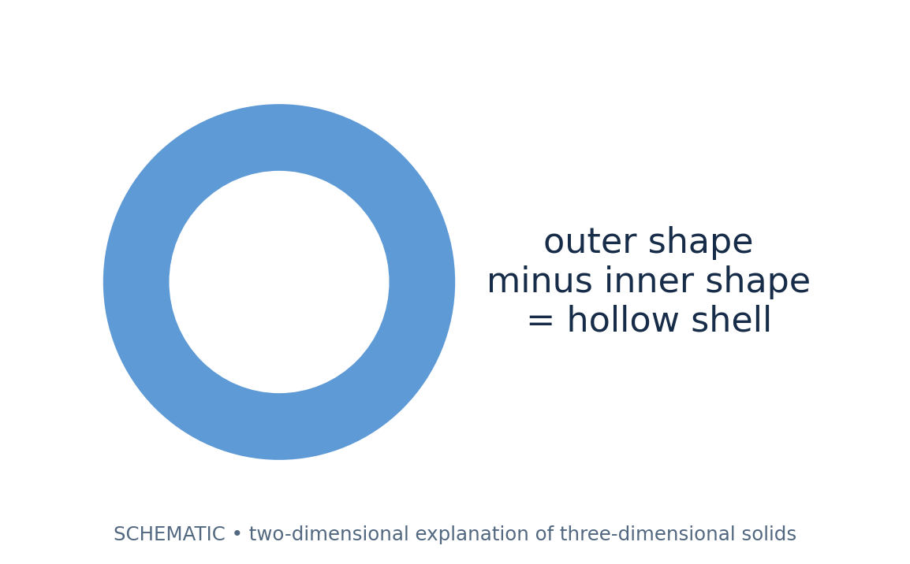

The illustration is two-dimensional, while Geant4 performs the operation in three dimensions. A boolean cut changes actual particle transport geometry, unlike hiding an object in the viewer. The current guide inner void includes the radial coupling layer. Geometry overlap audits and point-containment tests help identify mistakes, but a sampled audit is not a mathematical proof that every boundary is correct.

**ACTUAL C++ / CONFIG** — `src/DetectorConstruction.cc:234`

```cpp
new G4SubtractionSolid("hemisphereNorthScint", scint_hemisphere_virgin, gasketBox,
                       gasketIdentityMatrix, (gasketTrans * -1.0));
```

- G4SubtractionSolid subtracts the second solid.
- The transformation controls the cut location.

Sources: [model: Current baseline and assumptions](../../../docs/ray_baseline.md).

## Slide 032 — Why overlap checks matter

**03 / BUILD THE DETECTOR**

- Two materials should not occupy the same interior point.
- Shared touching surfaces can be intentional.
- The baseline audit found zero reported overlaps.

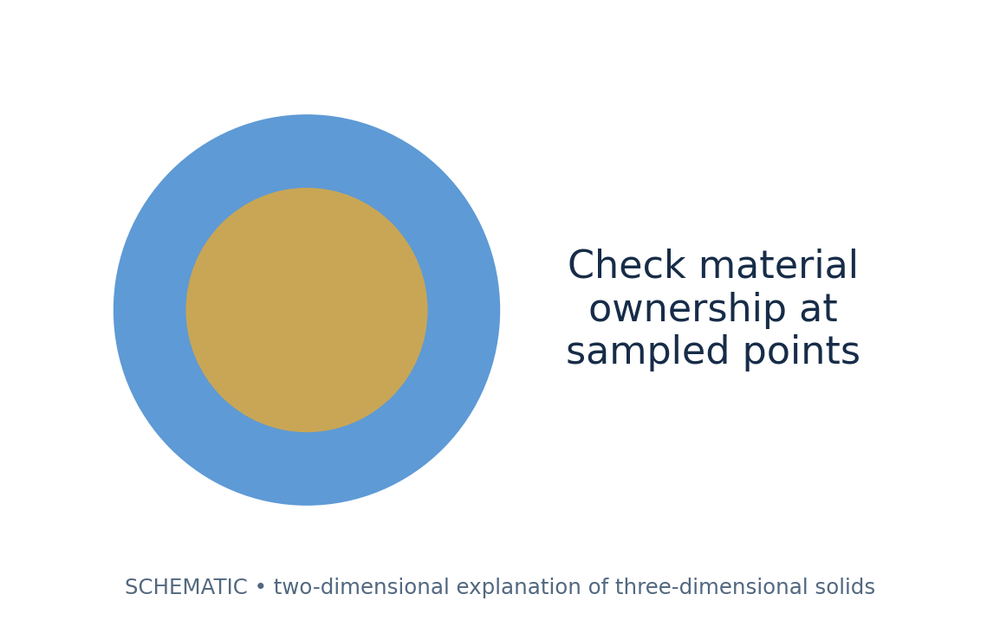

The saved baseline check sampled 1,000 points per volume across 2,056 volumes, at a 0.001 mm tolerance. Zero reports is useful evidence but not proof of perfect geometry. Exact adjacency can be valid; overlapping interiors usually indicate construction mistakes. The detector tests also verify hemisphere/seam partitions and the count of unique sensors. We do not change detector dimensions during this presentation task.

**TERMINAL COMMAND** — `Run from the spherical-pet project`

```bash
./build/spherical-pet -r 1 \
    --overlap-samples 1000 \
    -o results/overlap_lesson
```

- Geometry mode runs the overlap audit.
- geometry_check.json records the result.

Sources: [model: Current baseline and assumptions](../../../docs/ray_baseline.md).

## Slide 033 — Construction checkpoint: explain the layers aloud

**03 / BUILD THE DETECTOR**

- Air cavity → GAGG → coupling → guide → SiPM.
- The crystal outer diameter is 69 mm.
- A cutaway drawing still represents a full-sphere simulation.


Ask the learner to name which layer generates light and which records it. The crystal generates scintillation; sensors record accepted photons. The light guide transports and spreads light rather than replacing the scintillator. The guide shape and array count do not turn the crystal into 32 separate scintillator blocks.

**TEACHING PYTHON** — `Illustration; not the transport engine`

```python
layers = ["air", "GAGG", "coupling",
          "guide", "SiPM"]
print(" -> ".join(layers))
print(2 * 34.5)  # crystal diameter, mm
```

- join combines labels into a readable chain.
- Diameter equals twice the radius.

**Checkpoint:** Is the detector a solid GAGG ball?

**Answer:** No. It is a hollow GAGG shell surrounding an air cavity.

Sources: [model: Current baseline and assumptions](../../../docs/ray_baseline.md).

## Slide 034 — The particle source is defined explicitly

**04 / FOLLOW ONE GAMMA**

- Our primary is one gamma.
- It starts at the center with 511 keV.
- Its initial direction is +z.


The word primary means a particle injected by the source. It does not mean the particle remains unchanged forever or is the only particle in the event. Source commands are saved after configuration and any source-macro overrides, so they are stronger evidence than remembering a command line. The present source is a point, not a finite radioactive object.

**ACTUAL SAVED COMMANDS** — `results/ray_baseline_20261113/source_commands.mac`

```text
/gps/particle gamma
/gps/energy 511 keV
/gps/pos/type Point
/gps/pos/centre 0 0 0 mm
/gps/direction 0 0 1
```

- /gps commands configure the General Particle Source.
- Direction (0,0,1) points along +z.

Sources: [run: Saved GAGG reference run](../../../results/ray_baseline_20261113/); [model: Current baseline and assumptions](../../../docs/ray_baseline.md).

## Slide 035 — A run contains events; an event contains tracks

**04 / FOLLOW ONE GAMMA**

- A run groups a requested number of events.
- An event contains its primary and all descendants.
- Every tracked particle gets its own identity.

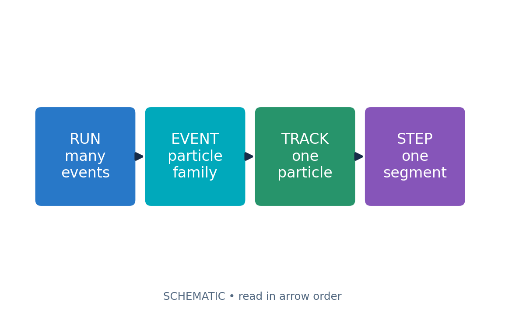

For this baseline, one event has one primary gamma. More generally, Geant4 can have multiple primaries in an event, so our definition is specific to the selected source. A track corresponds to one particle history, while the event contains all tracks that follow from the primary. A run can contain events that deposit no crystal energy as well as events with many secondary particles.

**ACTUAL C++ / CONFIG** — `src/main.cc:594`

```cpp
rm->BeamOn(c.integer("events"));
```

- BeamOn asks Geant4 to simulate the event count.
- One BeamOn is supported per application invocation.

Sources: [track: Geant4 tracking](https://geant4.web.cern.ch/documentation/dev/bfad_html/ForApplicationDevelopers/TrackingAndPhysics/tracking.html); [model: Current baseline and assumptions](../../../docs/ray_baseline.md).

## Slide 036 — The gamma does not interact at a fixed distance

**04 / FOLLOW ONE GAMMA**

- Interaction distance is sampled from a probability law.
- Some gammas interact; some escape.
- One event cannot establish detector efficiency.

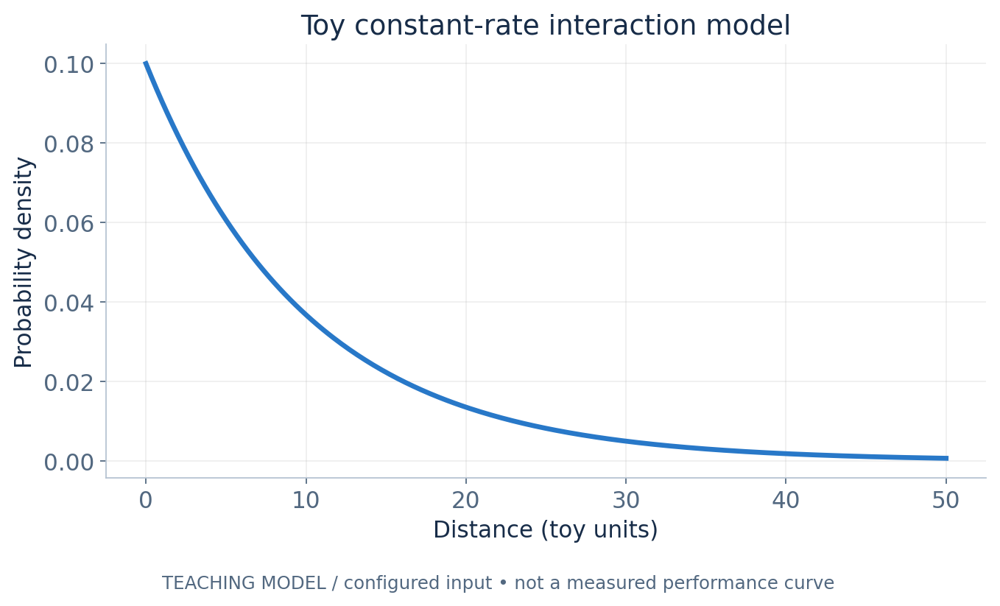

This example explains probabilistic transport only. Real Geant4 interactions depend on particle energy, material composition, density and competing processes. The application does not use this five-line Python model. A photon traversing a thin material can leave without an interaction; it is not guaranteed to stop at the first surface. The exponential distribution illustrates a constant-rate homogeneous case.

**TEACHING PYTHON** — `Illustration; not the transport engine`

```python
import random, math
rng = random.Random(42)
mean_free_path = 10  # toy units
distance = -mean_free_path * math.log(
    1 - rng.random())
```

- This samples an exponential distance in a toy model.
- 10 is not a calibrated GAGG interaction length.

Sources: [model: Current baseline and assumptions](../../../docs/ray_baseline.md).

## Slide 037 — Compton scattering shares energy with an electron

**04 / FOLLOW ONE GAMMA**

- The gamma continues after the interaction.
- Its energy decreases and direction changes.
- A released electron carries part of the energy.

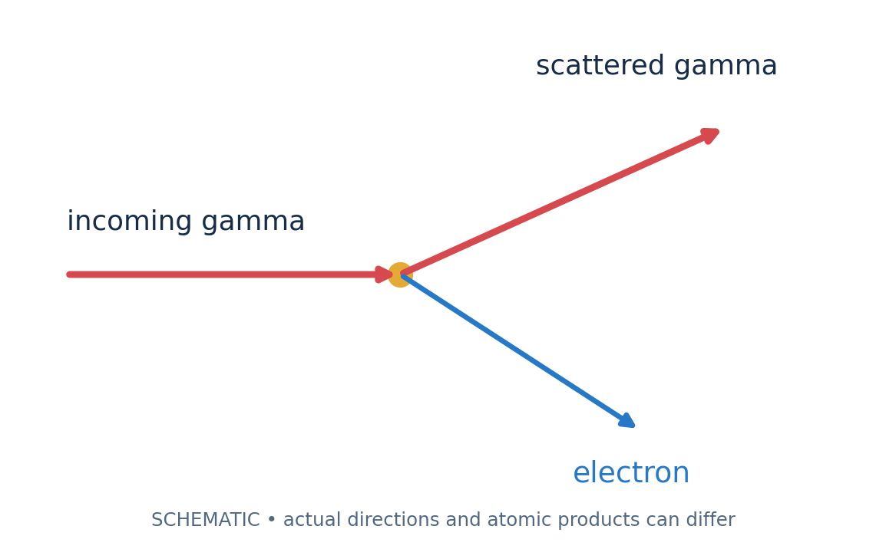

The result is about 14.622 keV. In the full atomic model, energy can be shared among an electron and atomic-relaxation products. The gamma step local deposit is only 0.01419 keV in this first row, because much of the transferred energy is carried away by secondary particles and deposited later. Do not read the tiny local number as the total energy loss. Geant4 handles the interaction; our code records the result.

**TEACHING PYTHON** — `Illustration; not the transport engine`

```python
before_keV = 511.0
after_keV = 496.378143292
energy_lost_keV = before_keV - after_keV
print(energy_lost_keV)
```

- The subtraction uses the first saved interaction.
- Energy loss is not identical to local step deposit.

Sources: [compton: Geant4 Compton scattering](https://geant4.web.cern.ch/documentation/pipelines/master/prm_html/PhysicsReferenceManual/electromagnetic/gamma_incident/compton/compton.html); [run: Saved GAGG reference run](../../../results/ray_baseline_20261113/).

## Slide 038 — Photoelectric absorption ends that gamma track

**04 / FOLLOW ONE GAMMA**

- The incoming gamma is absorbed.
- An electron is released from the atom.
- Atomic relaxation can add secondary particles.

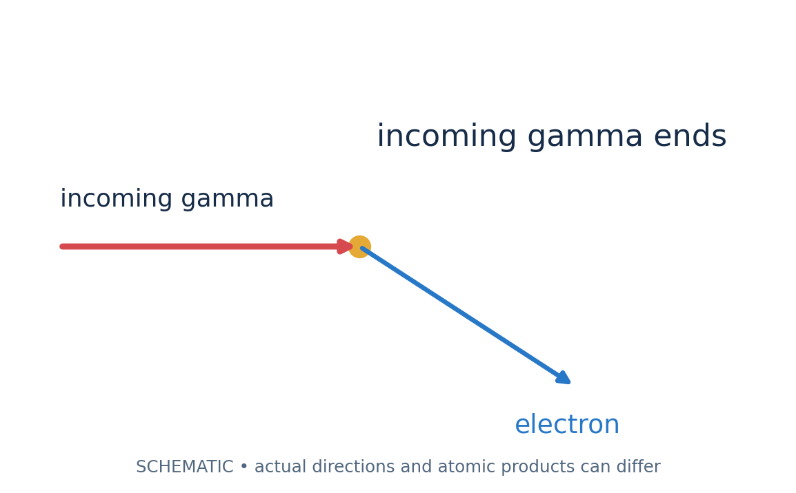

This example uses the final primary-gamma interaction in reference event 0. A new fluorescence photon may then travel elsewhere; it has its own track ID. Absorption of the primary therefore does not mean every secondary particle has already stopped. In the saved event a roughly 43 keV secondary photon is later absorbed nearby. The full event continues until its relevant particle histories are complete.

**TEACHING PYTHON** — `Illustration; not the transport engine`

```python
process = "phot"
pre_energy_keV = 136.686786359
post_energy_keV = 0.0
print(process, post_energy_keV)
```

- phot is the recorded process name.
- Zero post-energy marks absorption of that gamma.

Sources: [photo: Geant4 photoelectric effect](https://geant4.web.cern.ch/documentation/pipelines/master/prm_html/PhysicsReferenceManual/electromagnetic/gamma_incident/photoelectric/photoelec.html); [run: Saved GAGG reference run](../../../results/ray_baseline_20261113/).

## Slide 039 — Rayleigh scattering changes direction, not energy

**04 / FOLLOW ONE GAMMA**

- A gamma can change direction without ionizing an atom.
- Its energy is essentially unchanged in this model.
- Do not label every gamma interaction as a light source.

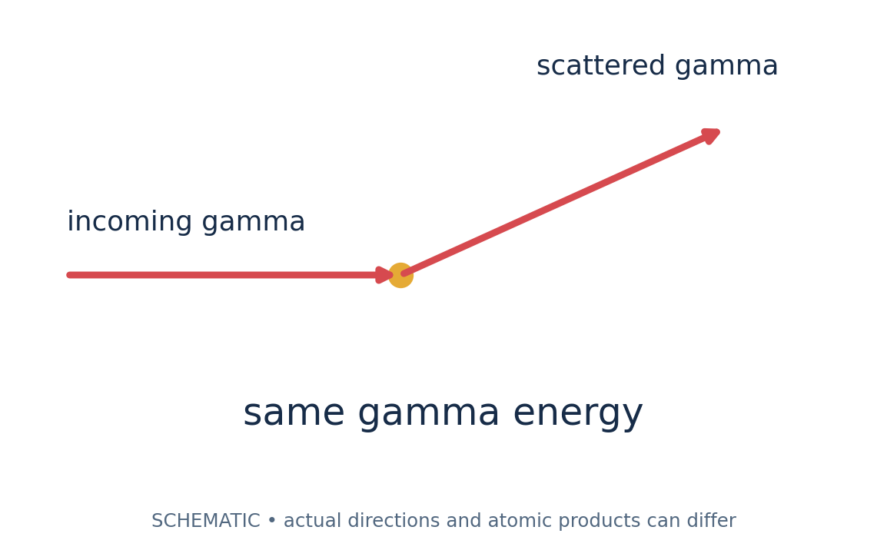

The reference event includes a Rayl process between its fourth Compton scatter and final photoelectric absorption. That history matters for the gamma trajectory. However, selecting CNN labels from all recorded gamma rows without checking process type could mistakenly choose a non-energy-depositing Rayleigh site. The application preserves the history rather than making that later label-selection decision for the user.

**TEACHING PYTHON** — `Illustration; not the transport engine`

```python
before = 136.686786359
after = 136.686786359
assert before == after
local_deposit = 0
```

- These values match the saved Rayl row.
- A zero-deposit scatter is retained as history.

Sources: [run: Saved GAGG reference run](../../../results/ray_baseline_20261113/); [model: Current baseline and assumptions](../../../docs/ray_baseline.md).

## Slide 040 — Electrons make a short trail of energy deposits

**04 / FOLLOW ONE GAMMA**

- Released electrons move through the crystal.
- They lose energy through interactions with matter.
- Those deposits drive scintillation generation.

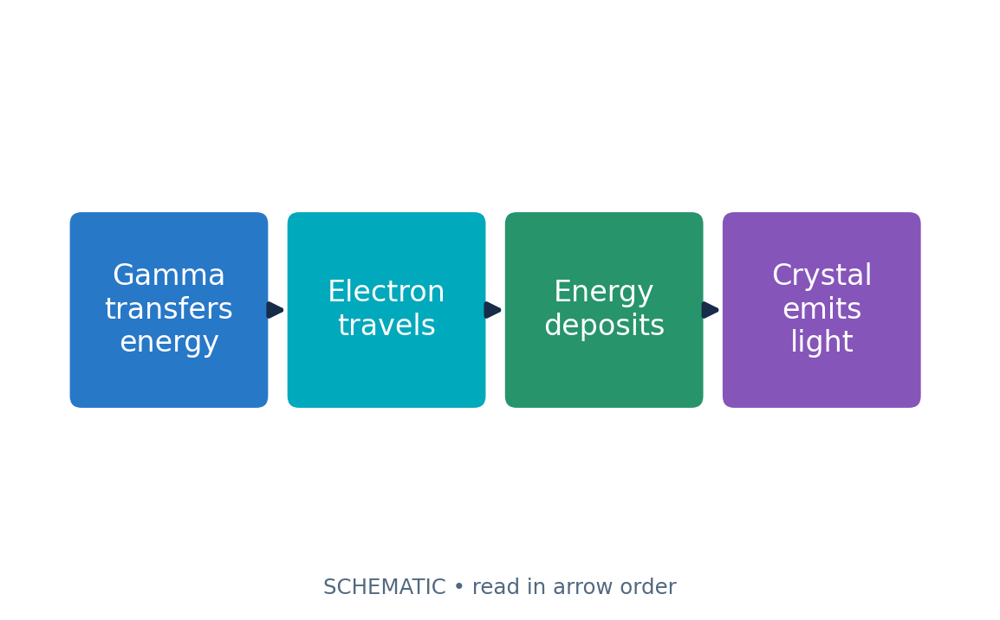

The blue electron paths may be hard to see because they are short relative to the entire detector and can be hidden by cyan optical trajectories. The scintillation light is created along charged-particle steps, not necessarily at one mathematical point. The model sums deposits from all non-optical particles in the selected scintillator. It avoids adding optical-photon energy again to the deposited-energy account.

**ACTUAL C++ / CONFIG** — `src/main.cc:254`

```cpp
if (!opt && inScintillator)
    s.edep += st->GetTotalEnergyDeposit();
```

- Non-optical deposits in the selected crystal are summed.
- Optical energy is not counted again in that total.

Sources: [run: Saved GAGG reference run](../../../results/ray_baseline_20261113/); [model: Current baseline and assumptions](../../../docs/ray_baseline.md).

## Slide 041 — Scintillation: excited crystal, then light emission

**04 / FOLLOW ONE GAMMA**

- Deposited energy excites the material.
- The material releases some of that energy as light.
- Many photons leave in different directions.

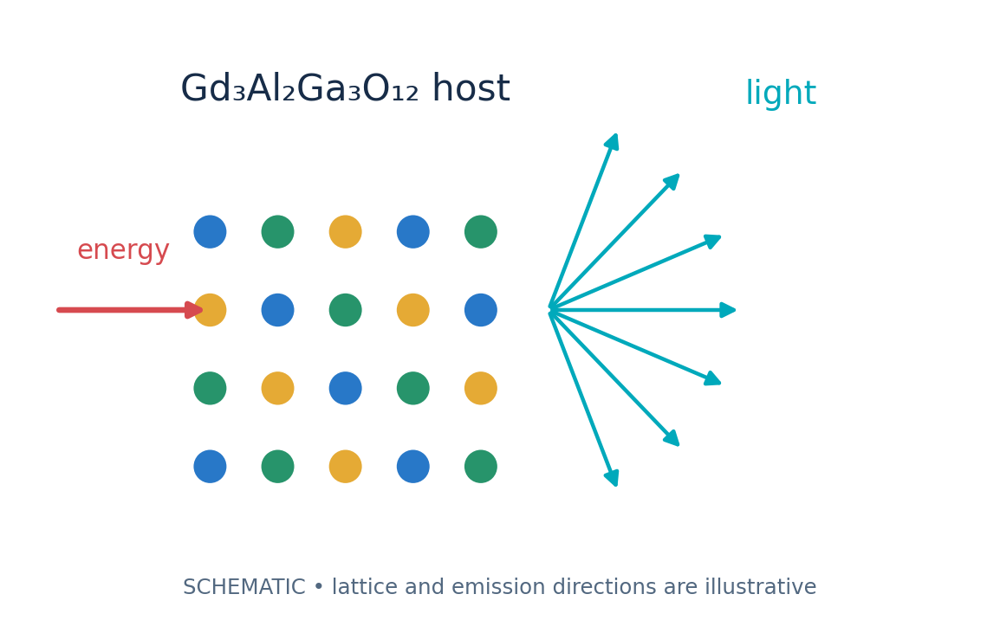

Think of the crystal as an energy converter. The gamma does not simply split into thousands of identical gamma photons. Electrons deposit energy, and the scintillation process emits optical photons with the chosen spectrum and time distribution. The software uses a statistical generation model; emitted photon number varies from event to event. The figure is schematic, with optical rays enlarged for visibility.

**ACTUAL C++ / CONFIG** — `src/DetectorConstruction.cc:215`

```cpp
scintTable->AddConstProperty("SCINTILLATIONYIELD", config.number(prefix + "yield") / keV);
scintTable->AddConstProperty("RESOLUTIONSCALE", 1.0);
```

- SCINTILLATIONYIELD sets photons per energy.
- RESOLUTIONSCALE controls yield fluctuations.

Sources: [scint: Geant4 scintillation model](https://geant4.web.cern.ch/documentation/pipelines/master/bfad_html/ForApplicationDevelopers/TrackingAndPhysics/physicsProcess.html).

## Slide 042 — Predict the light yield with one multiplication

**04 / FOLLOW ONE GAMMA**

- The provisional yield is 57 photons per keV.
- A full 511 keV deposit suggests about 29,127 photons.
- The actual scintillation count fluctuates around its mean.

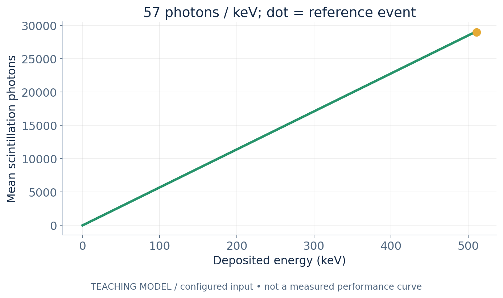

The reference event has 28,983 scintillation photons. Its total optical count is 29,002 because Cherenkov production adds 19 photons. Do not use the primary energy in this formula when the gamma deposits only part of its energy. For event 2, the crystal deposit is only about 37.68 keV, so its light output is much smaller. The yield parameter is representative rather than calibrated to the intended crystal.

**TEACHING PYTHON** — `Illustration; not the transport engine`

```python
energy_deposited_keV = 511
yield_per_keV = 57
mean_photons = energy_deposited_keV * yield_per_keV
print(mean_photons)  # 29127
```

- Multiply deposited energy by scintillation yield.
- This predicts a mean, not an exact event count.

Sources: [run: Saved GAGG reference run](../../../results/ray_baseline_20261113/); [model: Current baseline and assumptions](../../../docs/ray_baseline.md).

## Slide 043 — The spectrum chooses the photon energies

**04 / FOLLOW ONE GAMMA**

- A spectrum is a distribution of light intensity versus energy.
- The current model uses a narrow flat placeholder.
- A measured spectrum can replace it through a CSV file.

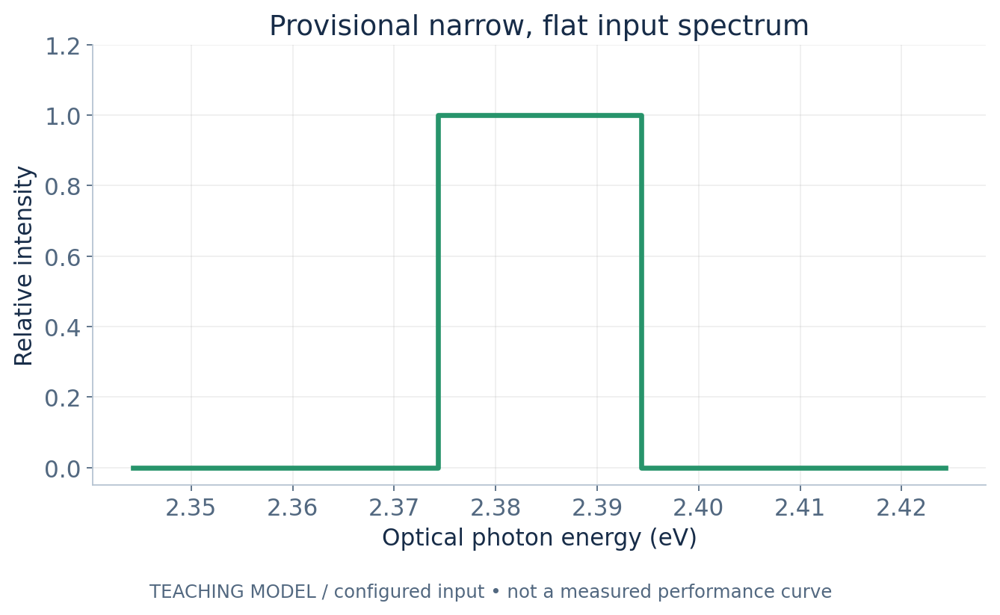

The GAGG center is about 2.3843 eV, corresponding to 520 nm. Flat width 0.02 eV is an explicit simplification, not a measured GAGG spectrum. Tables must use increasing energy and nonnegative intensity. A spectrum supplied per wavelength needs a change-of-variable conversion if its intensity is a density; simply reversing the axis can distort the distribution. This matters because sensor efficiency varies with photon wavelength.

**CONFIG EXAMPLE** — `Supported options; values as shown`

```text
scint-energy-ev = auto
scint-width-ev = 0.02
# Optional replacement:
# spectrum = measured_energy_spectrum.csv
```

- auto chooses the material-specific center.
- A spectrum CSV uses energy_eV,intensity.

Sources: [model: Current baseline and assumptions](../../../docs/ray_baseline.md).

## Slide 044 — Emission time is a distribution, not a stopwatch

**04 / FOLLOW ONE GAMMA**

- Different light photons are emitted at different times.
- The provisional decay constant is 88 ns.
- Longer optical paths also delay arrival.

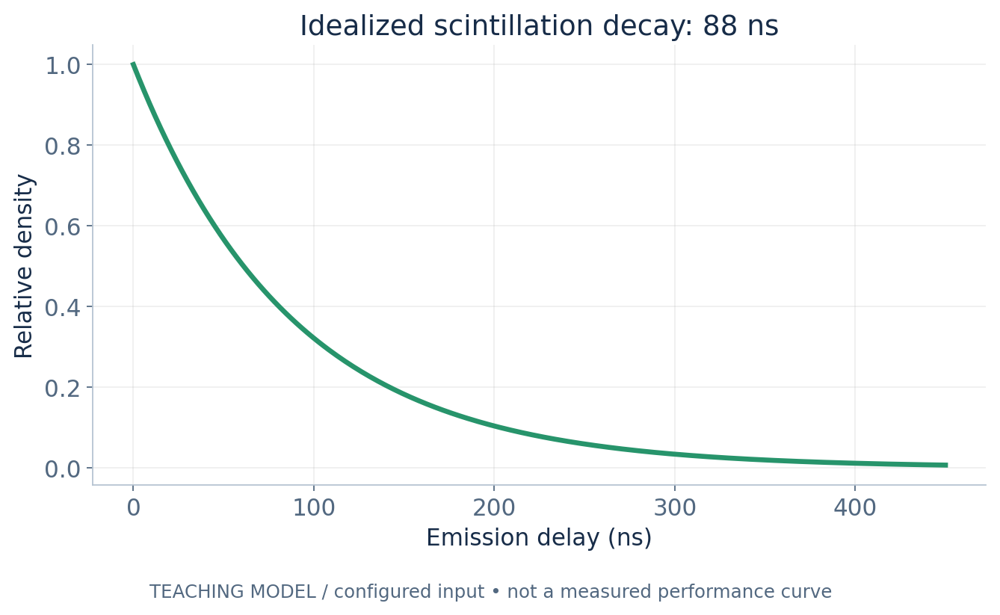

For a single exponential component, 88 ns is the characteristic timescale. It does not mean every photon arrives after 88 ns. Arrival time combines creation time, propagation time and any earlier particle history. The current application does not add electronic timing jitter. The plot shows the ideal exponential shape and should not be mistaken for the measured reference arrival histogram, which appears later.

**TEACHING PYTHON** — `Illustration; not the transport engine`

```python
import random, math
rng = random.Random(42)
tau_ns = 88
delay_ns = -tau_ns * math.log(
    1 - rng.random())
```

- The toy sample illustrates exponential emission delay.
- A decay constant is not a fixed delay for each photon.

Sources: [model: Current baseline and assumptions](../../../docs/ray_baseline.md); [scint: Geant4 scintillation model](https://geant4.web.cern.ch/documentation/pipelines/master/bfad_html/ForApplicationDevelopers/TrackingAndPhysics/physicsProcess.html).

## Slide 045 — Cherenkov light is a small second contribution here

**04 / FOLLOW ONE GAMMA**

- A charged particle can outrun light’s phase speed in a material.
- That can produce Cherenkov optical photons.
- Reference event 0 has 19 of them.

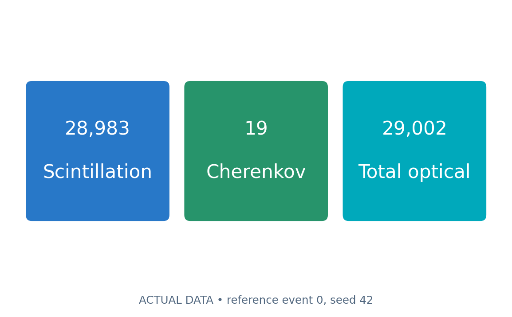

The particle does not exceed the speed of light in vacuum. The relevant comparison is with light's phase speed in that medium. This effect is different from scintillation, although both create optical photons that then undergo optical transport. Here the saved event contains 28,983 scintillation photons and 19 Cherenkov photons. The chart uses counts, not energies.

**ACTUAL C++ / CONFIG** — `src/main.cc:239`

```cpp
if (p && p->GetProcessName() == "Cerenkov")
    ++s.cherenkov;
```

- Cerenkov is Geant4’s process spelling.
- The application counts this category separately.

Sources: [run: Saved GAGG reference run](../../../results/ray_baseline_20261113/); [optics: Geant4 optical processes](https://geant4.web.cern.ch/documentation/dev/bfad_html/ForApplicationDevelopers/TrackingAndPhysics/physicsProcess.html).

## Slide 046 — Energy bookkeeping needs the right ledger

**04 / FOLLOW ONE GAMMA**

- Primary gamma energy and deposited energy are different quantities.
- Some energy may leave with secondary particles.
- Do not add optical photon energy again to the deposit.

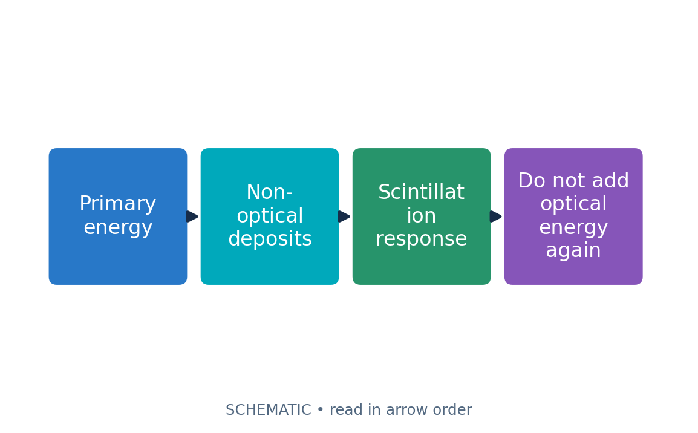

The difference may involve energy carried out of the scintillator or deposited in other materials. It is not necessarily all a single escaping gamma. Geant4 optical generation is modeled separately and should not be added to the ordinary event energy-balance total. In our application edep_scintillator_keV is the sum of non-optical deposits in the selected crystal. A primary energy of 511 keV does not guarantee a 511 keV crystal deposit.

**TEACHING PYTHON** — `Illustration; not the transport engine`

```python
primary_keV = 511
crystal_deposit_keV = 37.6816
other_or_escaping_keV = primary_keV - crystal_deposit_keV
print(other_or_escaping_keV)
```

- Event 2 deposits only part of the source energy.
- The difference is not automatically a lost-energy bug.

Sources: [run: Saved GAGG reference run](../../../results/ray_baseline_20261113/); [optics: Geant4 optical processes](https://geant4.web.cern.ch/documentation/dev/bfad_html/ForApplicationDevelopers/TrackingAndPhysics/physicsProcess.html).

## Slide 047 — Particle checkpoint: follow the causal chain

**04 / FOLLOW ONE GAMMA**

- Gamma interaction → energetic electron.
- Electron energy deposit → optical photons.
- Optical transport → some accepted sensor hits.


Ask the student to identify where energy is converted, where it is transported, and where it is measured. The guide does not create the dominant scintillation signal. The sensor does not directly report the original 511 keV in one optical hit. Several gamma interaction sites can contribute light to the same set of sensors, making position estimation challenging.

**TEACHING PYTHON** — `Illustration; not the transport engine`

```python
chain = ["gamma", "electron",
         "energy deposit", "light", "hit"]
print(" -> ".join(chain))
```

- The chain explains causes, not equal particle counts.
- One stage can produce many particles in the next.

**Checkpoint:** Does every optical photon carry 511 keV?

**Answer:** No. Modeled scintillation photons are near 2.38 eV; 511 keV belongs to the injected gamma.

Sources: [model: Current baseline and assumptions](../../../docs/ray_baseline.md).

## Slide 048 — Reflection and refraction change a light path

**05 / FOLLOW THE LIGHT**

- Reflection sends light back into its current material.
- Refraction changes direction as light enters another material.
- The boundary decision depends on optical properties.

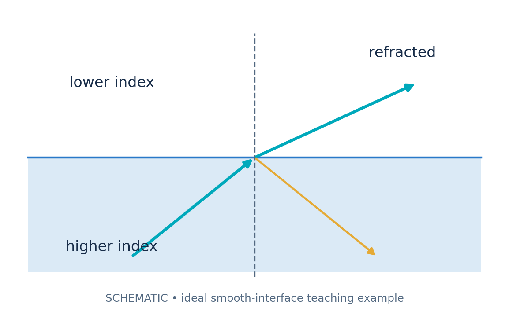

The schematic shows an incident ray, a reflected possibility and a refracted possibility. A Monte Carlo photon follows a sampled outcome; the drawing does not mean one tracked photon is duplicated at every ordinary boundary. Angles are measured from the surface normal, not from the surface itself. Surface texture and polarization can also affect behavior. Numerical angles in this figure are illustrative.

**CONFIG EXAMPLE** — `Supported options; values as shown`

```text
gagg-index = 1.9
coupling-index = 1.43
guide-index = 1.5
```

- Each number is a refractive index.
- Different indices create different optical interfaces.

Sources: [model: Current baseline and assumptions](../../../docs/ray_baseline.md); [optics: Geant4 optical processes](https://geant4.web.cern.ch/documentation/dev/bfad_html/ForApplicationDevelopers/TrackingAndPhysics/physicsProcess.html).

## Slide 049 — Total internal reflection can keep light inside

**05 / FOLLOW THE LIGHT**

- Light moving from higher to lower index can be trapped at steep angles.
- The critical angle depends on the two indices.
- Repeated reflection creates a long zigzag track.

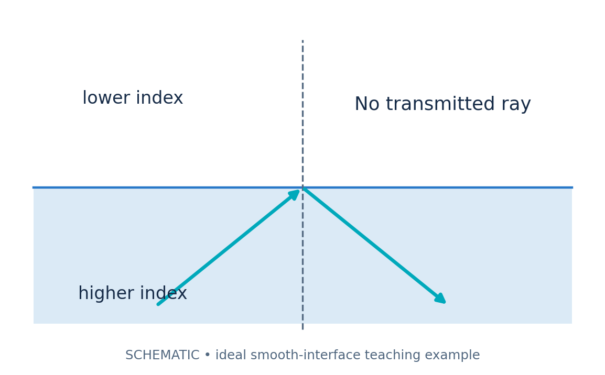

The formula applies when the first refractive index is larger than the second. The angle is measured from the normal. Our ground inner surface means an individual microfacet has a different local normal, so this single ideal angle does not summarize the entire rough interface. A refractive-index number alone does not establish collection efficiency. The calculation is a teaching approximation, not an alternative boundary engine.

**TEACHING PYTHON** — `Illustration; not the transport engine`

```python
import math
n_crystal, n_air = 1.9, 1.000172
critical = math.degrees(
    math.asin(n_air / n_crystal))
print(round(critical, 1))
```

- This ideal smooth-interface calculation gives about 31.8°.
- The actual ground surface samples local facet normals.

Sources: [model: Current baseline and assumptions](../../../docs/ray_baseline.md).

## Slide 050 — One photon, several reflections, one track

**05 / FOLLOW THE LIGHT**

- Each optical photon has its own track ID.
- A direction change does not create a new track.
- Many line segments can belong to the same photon.

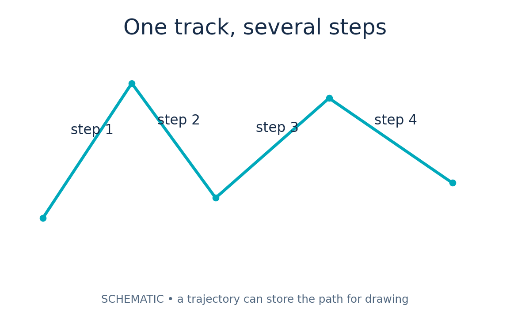

This is one of the main reasons the event screenshot looks crowded. One hundred drawn optical trajectories can contain many hundreds or thousands of segments. A stored trajectory is the display representation of a track. Steps are produced by the transport engine for boundaries, interactions and other numerical reasons; not every step means a physically visible collision.

**TEACHING PYTHON** — `Illustration; not the transport engine`

```python
track_id = 17
steps = ["created", "reflected",
         "refracted", "accepted"]
for step in steps:
    print(track_id, step)
```

- The ID stays fixed throughout the example.
- A new secondary particle receives a new ID.

Sources: [track: Geant4 tracking](https://geant4.web.cern.ch/documentation/dev/bfad_html/ForApplicationDevelopers/TrackingAndPhysics/tracking.html); [model: Current baseline and assumptions](../../../docs/ray_baseline.md).

## Slide 051 — A cyan line may cross the hollow center

**05 / FOLLOW THE LIGHT**

- The bare inner boundary can transmit optical light into air.
- A photon can cross the cavity and reach another region.
- A 2D screen also overlays paths at different depths.

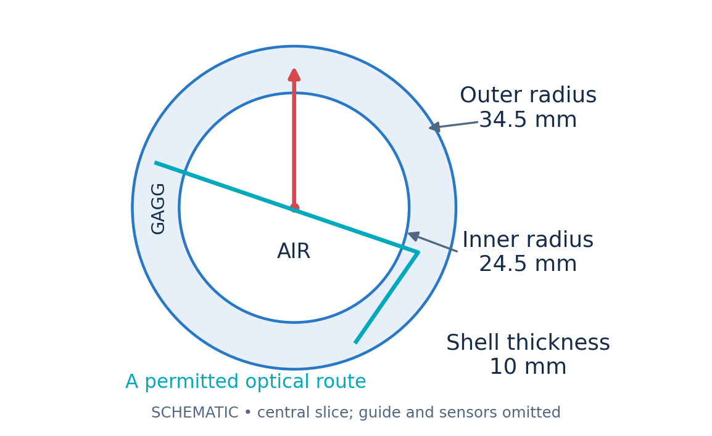

A line crossing the apparent central disk is not automatically evidence of a geometry bug. It may truly pass through the air cavity, or it may be a foreground/background projection. The source itself does not create all cyan photons in the center; most scintillation photons originate along electron paths in the GAGG. The schematic shows one permitted optical route under the current bare-interface assumption.

**CONFIG EXAMPLE** — `Supported options; values as shown`

```text
inner-surface = bare
# Optional study, not the baseline:
# inner-surface = reflector
```

- The boundary choice changes actual transport.
- Rotating the viewer only changes the view.

Sources: [model: Current baseline and assumptions](../../../docs/ray_baseline.md).

## Slide 052 — Absorption ends a light photon’s journey

**05 / FOLLOW THE LIGHT**

- Bulk absorption can occur while light travels through a material.
- A coating can absorb at a boundary.
- Longer paths usually give more opportunities for bulk loss.

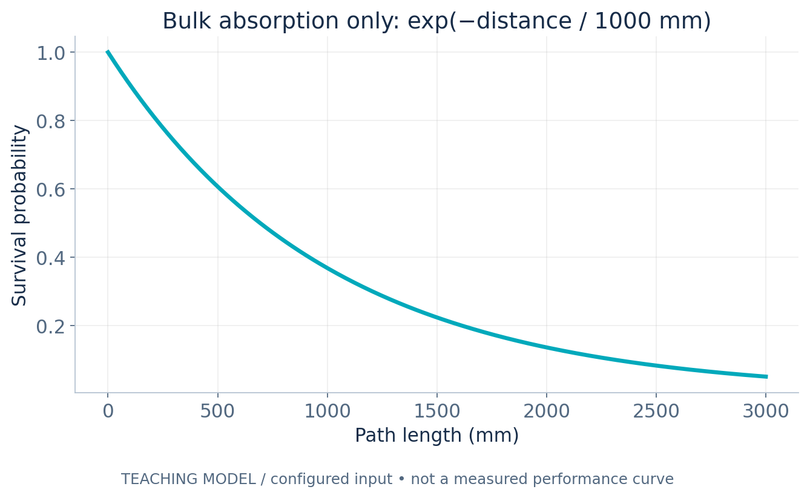

An absorption length is not a hard distance cutoff. In a simple homogeneous case, the survival probability after one absorption length is exp(-1), about 37 percent. The 1000 mm value is provisional for GAGG, guide and coupling here; it is not established by the sample-transmission paper. Boundary reflection, scattering and sensor acceptance are separate effects, so this calculation is not a detector-efficiency prediction.

**TEACHING PYTHON** — `Illustration; not the transport engine`

```python
import math
path_mm = 100
absorption_length_mm = 1000
survival = math.exp(-path_mm / absorption_length_mm)
print(round(survival, 3))
```

- This homogeneous-path illustration gives about 0.905.
- It ignores interfaces and all other loss mechanisms.

Sources: [model: Current baseline and assumptions](../../../docs/ray_baseline.md).

## Slide 053 — The light guide can spread light across sensors

**05 / FOLLOW THE LIGHT**

- One interaction can illuminate many SiPMs.
- The pattern depends on position and geometry.
- That pattern carries information for later reconstruction.

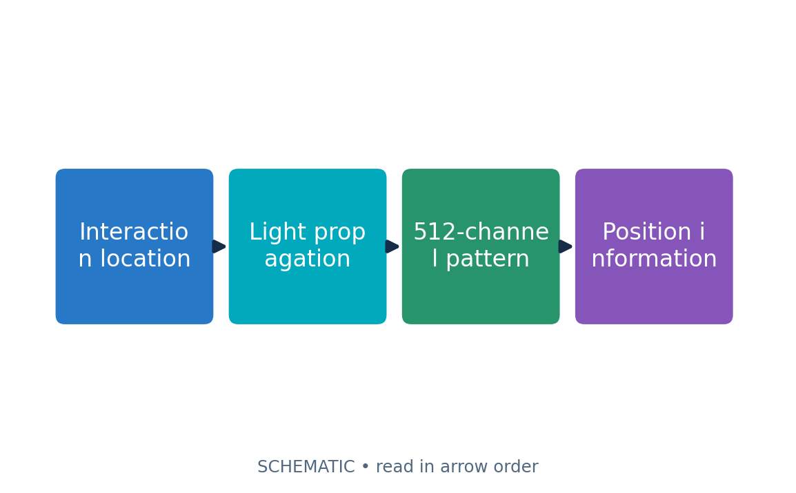

The guide is not guaranteed to spread light uniformly. Actual geometry, reflections and sensor gaps can create complicated patterns. Normalization can be useful in an analysis, but it removes total-light information and should be chosen deliberately. The application saves raw counts rather than committing to a specific CNN preprocessing representation. The actual 512-channel event pattern appears later.

**TEACHING PYTHON** — `Illustration; not the transport engine`

```python
counts = [2, 8, 25, 11, 3]
total = sum(counts)
pattern = [n / total for n in counts]
print(pattern)
```

- Normalization divides each count by the total.
- This five-sensor example is illustrative.

Sources: [model: Current baseline and assumptions](../../../docs/ray_baseline.md).

## Slide 054 — How a real SiPM responds to a photon

**05 / FOLLOW THE LIGHT**

- A photon can trigger a microscopic avalanche cell.
- The avalanche produces an electrical pulse.
- Many cells share one sensor output.

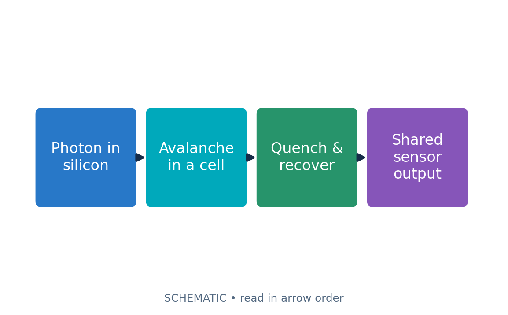

An avalanche is a multiplication of charge carriers in a strong electric field, not a mechanical event. A resistor quenches the current so a cell can recover. Real detectors have noise, recovery and saturation effects. The application has reference sensor filtering but does not simulate electronic waveforms or invoke the G4SiPM digitizer. Do not interpret accepted hit counts as calibrated ADC values.

**FUTURE / PSEUDOCODE** — `Concept only; not implemented here`

```text
photon enters active silicon
if it triggers an avalanche:
    a microcell produces a pulse
combine cell pulses at sensor output
```

- This is a physical explanation, not the application’s digitizer.
- The present app stores accepted photon hits.

Sources: [sipm: Hamamatsu: what is an MPPC / SiPM?](https://www.hamamatsu.com/us/en/product/optical-sensors/mppc/what_is_mppc.html); [sipmphysics: Hamamatsu: SiPM operation](https://hub.hamamatsu.com/us/en/technical-notes/mppc-sipms/physics-and-operation-of-the-MPPC-silicon-photomultiplier.html); [model: Current baseline and assumptions](../../../docs/ray_baseline.md).

## Slide 055 — Reaching a sensor is not the same as being accepted

**05 / FOLLOW THE LIGHT**

- A photon must reach an appropriate active region.
- The reference filter applies a detection probability.
- Accepted hits can be fewer than incident photons.

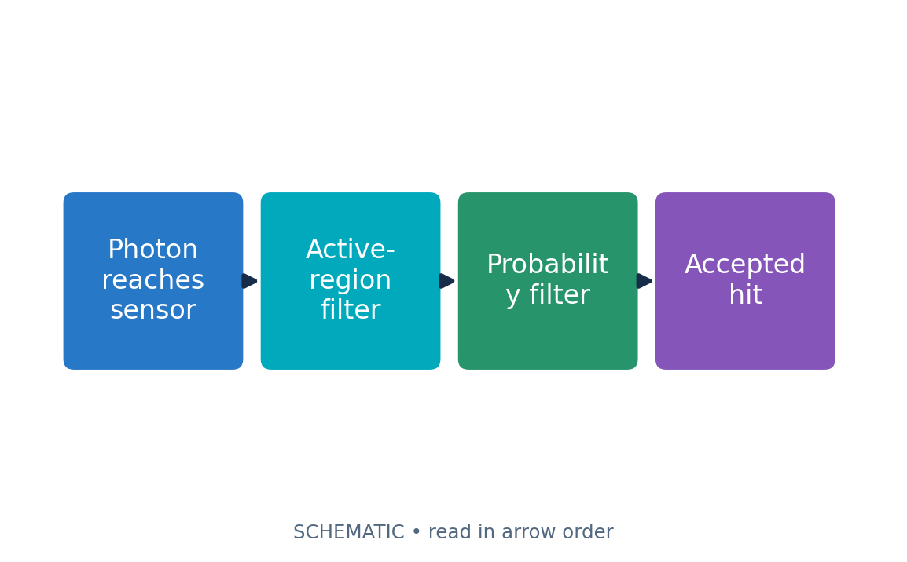

PDE means photon detection efficiency. In this library, the tabulated sensor response is corrected for fill factor and window transmission before this probability check; geometry filtering is applied separately. Therefore multiplying another fill factor or PDE into saved accepted hits would double-apply effects. The displayed three lines are part of the actual reference filter, not a complete model of a real sensor.

**ACTUAL C++ / CONFIG** — `third_party/g4sipm/src/hit/G4SipmSensitiveDetectorFilter.cc:53`

```cpp
if (G4UniformRand() <= pde) {
	return true;
}
```

- G4UniformRand() draws a random number.
- pde is the library’s corrected acceptance quantity.

Sources: [model: Current baseline and assumptions](../../../docs/ray_baseline.md); [sipmphysics: Hamamatsu: SiPM operation](https://hub.hamamatsu.com/us/en/technical-notes/mppc-sipms/physics-and-operation-of-the-MPPC-silicon-photomultiplier.html).

## Slide 056 — A hit stores who, where, when and how energetic

**05 / FOLLOW THE LIGHT**

- Sensor ID identifies the detector channel.
- Track ID identifies the accepted photon.
- Time and position describe its arrival.

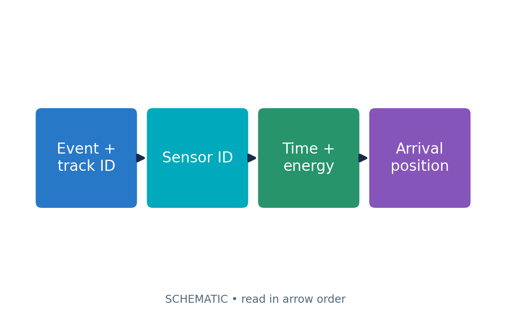

Global time is measured from the event time origin, in Geant4 internal units before CSV conversion to nanoseconds. It includes emission and propagation delays, not electronic jitter. A hit is not the original gamma interaction position. It is the recorded optical-photon acceptance at the sensor. The full record also contains photon energy and arrival position.

**ACTUAL C++ / CONFIG** — `third_party/g4sipm/src/hit/G4SipmSensitiveDetector.cc:49`

```cpp
hit->setTrackId(step->GetTrack()->GetTrackID());
hit->setSipmId(sipm->getId());
hit->setTime(stepPoint->GetGlobalTime());
```

- The first two lines save particle and sensor identifiers.
- The third saves global arrival time.

Sources: [model: Current baseline and assumptions](../../../docs/ray_baseline.md).

## Slide 057 — Many hits can belong to one sensor

**05 / FOLLOW THE LIGHT**

- There are 512 sensors in the sphere.
- One sensor can accept several photons in an event.
- Event 0 has 1,099 hits on 303 sensors.

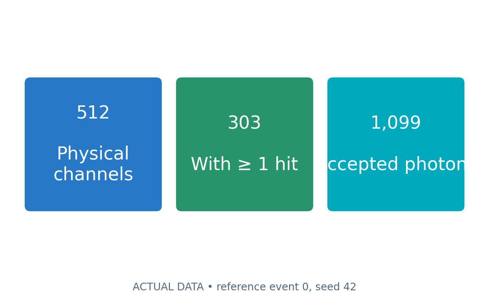

This example separates three easily confused numbers: physical sensors, hit-bearing sensors and accepted photons. The actual event has 512 physical channels, 303 with at least one accepted hit, and 1,099 accepted-photon records. Those counts say nothing by themselves about the number of gamma interaction sites. The toy list deliberately repeats IDs to make the difference visible.

**TEACHING PYTHON** — `Illustration; not the transport engine`

```python
from collections import Counter
sensor_ids = [4, 4, 4, 9, 9]
counts = Counter(sensor_ids)
print(len(sensor_ids), len(counts))
# 5 hits, 2 sensors
```

- The number of records counts hits.
- The number of unique IDs counts hit-bearing sensors.

Sources: [run: Saved GAGG reference run](../../../results/ray_baseline_20261113/).

## Slide 058 — A lost photon does not automatically mean a bug

**05 / FOLLOW THE LIGHT**

- Light can be absorbed, escape or fail acceptance.
- The simulation counts how optical tracks terminate.
- Guard kills are a separate numerical warning.

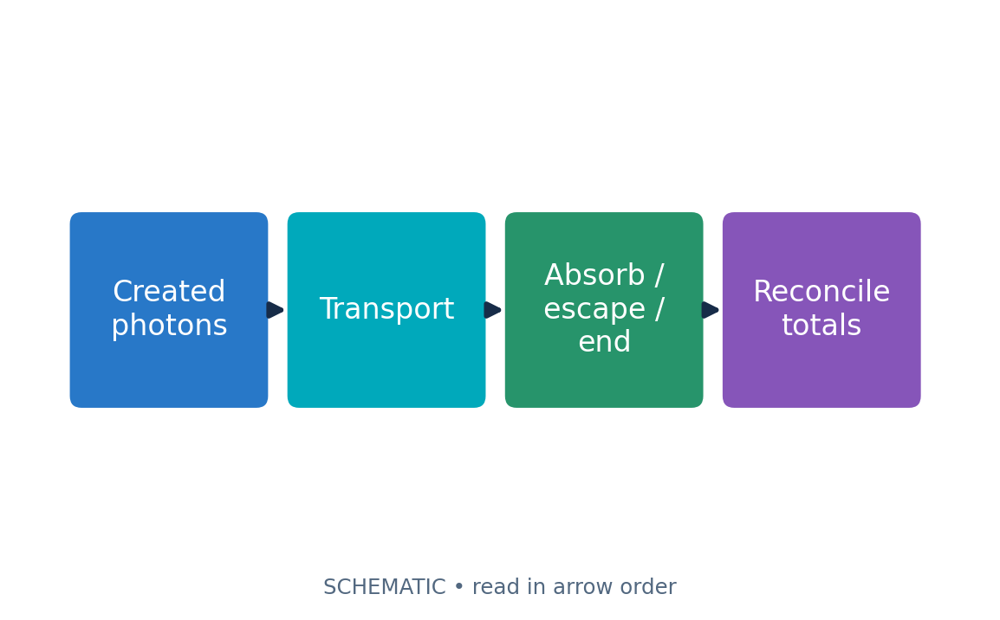

The actual summary uses mutually exclusive termination categories. Some optical photons end in sensitive volumes without becoming accepted hits. Thus the sensor_sensitive_volume category cannot be equated with sipm_accepted_hits. The guard stops tracks that exceed the configured maximum steps; a nonzero guard count makes the application fail so results are not silently treated as complete. Zero guard kills does not prove the optical model is calibrated.

**TEACHING PYTHON** — `Illustration; not the transport engine`

```python
endings = {"absorbed": 7,
           "sensor_region": 2, "escaped": 1}
created = 10
assert sum(endings.values()) == created
```

- This toy ledger checks that every photon has an ending.
- Sensor-region endings are not all accepted hits.

Sources: [model: Current baseline and assumptions](../../../docs/ray_baseline.md).

## Slide 059 — A map of the application files

**06 / HOW THE CODE WORKS**

- Config.cc reads and checks your choices.
- DetectorConstruction.cc creates materials and geometry.
- main.cc connects physics, source, tracking and output.


The project contains a small application around Geant4 and a bundled G4SiPM library. Main.cc includes several action classes rather than splitting every action into a separate file. Configuration exposes useful parameters, but not every historical shape constant is independently adjustable. Read docs/parameters.md for the supported options. The deck uses exact extracted snippets for implementation claims and labels conceptual code separately.

**TERMINAL COMMAND** — `Run from the spherical-pet project`

```bash
ls src include config
./build/spherical-pet --print-config
```

- ls shows the source organization.
- --print-config prints resolved settings without transport.

Sources: [model: Current baseline and assumptions](../../../docs/ray_baseline.md).

## Slide 060 — From command line to a running simulation

**06 / HOW THE CODE WORKS**

- Read configuration, then apply command-line overrides.
- Build geometry and initialize physics.
- Create events, collect data, and open the viewer if requested.


These registration calls connect user-defined classes to the Geant4 run manager. They do not execute the entire simulation immediately. Initialization builds the required geometry and physics tables; BeamOn later starts the event loop. The named action classes correspond to different timescales: run, event, track and step. The flowchart shows the normal path; invalid configuration or overlaps stop it before transport.

**ACTUAL C++ / CONFIG** — `src/main.cc:494`

```cpp
rm->SetUserInitialization(new DetectorConstruction(c));
rm->SetUserInitialization(new Physics(c));
rm->SetUserAction(new Primary);
rm->SetUserAction(new RunAction(state));
rm->SetUserAction(new EventAction(state));
rm->SetUserAction(new Tracking(state));
rm->SetUserAction(new Stepping(state));
```

- SetUserInitialization installs geometry and physics.
- SetUserAction registers what happens during a run.

Sources: [model: Current baseline and assumptions](../../../docs/ray_baseline.md).

## Slide 061 — The physics list selects families of processes

**06 / HOW THE CODE WORKS**

- Livermore electromagnetic physics handles gamma/electron interactions.
- Optical physics handles light generation and transport.
- Decay physics is registered, though our source is a gamma.


Geant4 supplies the detailed physics implementations; the application selects and configures them. Registering decay physics does not force a gamma to decay. The default 0.1 mm production range cut is not the viewer line length, not the detector spatial resolution and not generally a maximum tracking step. It is translated into material-dependent secondary-production thresholds. A precision study should investigate the relevant numerical settings.

**ACTUAL C++ / CONFIG** — `src/main.cc:89`

```cpp
RegisterPhysics(new G4EmLivermorePhysics(0));
RegisterPhysics(new G4DecayPhysics(0));
RegisterPhysics(new G4OpticalPhysics(0));
defaultCutValue = c.number("range-cut-mm") * mm;
```

- Each registration installs a group of processes.
- The range cut is a secondary-production control.

Sources: [model: Current baseline and assumptions](../../../docs/ray_baseline.md).

## Slide 062 — RunAction prepares files and final totals

**06 / HOW THE CODE WORKS**

- At run start, output files are opened.
- At run end, counts and energy totals are summarized.
- Existing output directories are protected.


A file stream is an object that writes text to disk. CSV means comma-separated values, a table format readable by many programs. RunAction also saves dense channel counts and gamma interaction records. The application permits one BeamOn per invocation and refuses to overwrite existing output directories. The protection is why a repeated command without -o can fail with Output already exists.

**ACTUAL C++ / CONFIG** — `src/main.cc:125`

```cpp
s.hits.open(s.out / "sipm_hits.csv");
s.tracks.open(s.out / "gamma_steps.csv");
```

- One stream writes accepted sensor photons.
- Another writes saved gamma steps.

Sources: [model: Current baseline and assumptions](../../../docs/ray_baseline.md).

## Slide 063 — EventAction resets, then collects one event

**06 / HOW THE CODE WORKS**

- Each event begins with fresh counters.
- At its end, all sensor hit collections are read.
- Even zero-hit events get an event record.


The run total is separate from the event total. If counters were not reset, later events would appear to include earlier photons. The code clears saved track IDs and gamma interaction indices as well as energy and production counts. EventAction later loops over the detector hit collections, writes accepted photons, then writes exactly 512 sensor-count rows for the event.

**ACTUAL C++ / CONFIG** — `src/main.cc:168`

```cpp
s.event = e->GetEventID();
s.savedOpticalTracks.clear();
s.gammaInteractionCounts.clear();
s.edep = 0;
s.optical = s.scint = s.cherenkov = s.killed = 0;
```

- The event ID tells records which event they belong to.
- Clearing counters prevents accidental carry-over.

Sources: [model: Current baseline and assumptions](../../../docs/ray_baseline.md).

## Slide 064 — TrackingAction runs when each track begins

**06 / HOW THE CODE WORKS**

- It recognizes optical photons.
- It counts their creation processes.
- It independently chooses which paths to draw or save.


The same action also uses vis-photons to select native display trajectories. These controls are separate. Drawing zero optical paths does not disable optical physics. Saving only a few tracks does not reduce the number of photons whose hits are recorded. The application samples the first created optical tracks for these diagnostics, not a random or representative sample.

**ACTUAL C++ / CONFIG** — `src/main.cc:233`

```cpp
++s.optical;
if (s.optical <= s.config.integer("track-photons"))
    s.savedOpticalTracks.insert(t->GetTrackID());
auto* p = t->GetCreatorProcess();
```

- The optical count increases for every optical track.
- track-photons selects IDs for CSV trajectory recording.

Sources: [model: Current baseline and assumptions](../../../docs/ray_baseline.md).

## Slide 065 — SteppingAction observes each small transport segment

**06 / HOW THE CODE WORKS**

- It adds crystal energy deposits.
- It records gamma interaction information.
- It can save selected optical steps and termination categories.


The pre-step material identifies where the step occurred for this score. The post-step process identifies what ended the step. The application records non-Transportation gamma interactions inside the scintillator, with track and parent IDs. Optical-step records include endpoints and times; the output does not currently provide a boundary-process status on every saved optical step. A direction change can still be seen by comparing successive segments.

**ACTUAL C++ / CONFIG** — `src/main.cc:252`

```cpp
const bool inScintillator = st->GetPreStepPoint()->GetMaterial()->GetName() ==
                             s.config.text("scintillator");
if (!opt && inScintillator)
    s.edep += st->GetTotalEnergyDeposit();
```

- The material name selects the scoring region.
- Only non-optical energy deposits enter this sum.

Sources: [model: Current baseline and assumptions](../../../docs/ray_baseline.md).

## Slide 066 — Sensor hits become a complete 512-channel vector

**06 / HOW THE CODE WORKS**

- Start every channel count at zero.
- Add one for each accepted photon on that sensor.
- Write every channel, including zeros.


The two counters answer different questions but must agree when sensor counts are summed. The code validates sensor IDs before indexing the array. Zero-hit channels are essential: they distinguish an unilluminated sensor from a missing record. The application stores raw channel counts without imposing the annular paper's 12×16 image layout on the spherical topology.

**ACTUAL C++ / CONFIG** — `src/main.cc:191`

```cpp
++counts[h->getSipmId()];
++n;
```

- counts[id] stores photons accepted by that sensor.
- n counts accepted photons across all sensors.

Sources: [model: Current baseline and assumptions](../../../docs/ray_baseline.md).

## Slide 067 — Display sampling is a separate decision

**06 / HOW THE CODE WORKS**

- All non-optical trajectories can be drawn.
- Only the first N optical trajectories are drawn.
- This choice leaves transport and hit acceptance unchanged.


This actual condition is the key to the screenshot. The count s.optical is checked before the current optical track is incremented. Setting vis-photons to 100 stores the first 100 optical trajectories. The physics simulation still transports all optical photons. Native regression tests compare event and hit output with batch mode to check that drawing does not change the event results.

**ACTUAL C++ / CONFIG** — `src/main.cc:228`

```cpp
const bool draw =
    !s.config.flag("batch") && (!optical || s.optical < s.config.integer("vis-photons"));
fpTrackingManager->SetStoreTrajectory(draw ? 1 : 0);
```

- !batch selects native-display mode.
- SetStoreTrajectory controls display storage.

Sources: [model: Current baseline and assumptions](../../../docs/ray_baseline.md).

## Slide 068 — Configuration files and command-line overrides

**06 / HOW THE CODE WORKS**

- The file supplies a reproducible baseline.
- Explicit command-line values override it.
- Resolved settings are saved with the output.


Print-config validates options and shows requested resolved settings without initializing Geant4. An optional source macro can then override source commands, so source_commands.mac records the actually applied sequence. Keep both files. Multiple configuration files are read in order; explicit CLI options win regardless of position. Input-file paths in a config are interpreted relative to that config file, while output paths are relative to the working directory.

**TERMINAL COMMAND** — `Run from the spherical-pet project`

```bash
./build/spherical-pet \
    --config config/ray_baseline.conf \
    -e 1 --vis-photons 5 \
    --print-config
```

- --config reads the baseline file.
- -e 1 selects one event despite other defaults.

Sources: [model: Current baseline and assumptions](../../../docs/ray_baseline.md).

## Slide 069 — The random seed gives a repeatable example

**06 / HOW THE CODE WORKS**

- Seed 42 is used for the teaching event.
- Changing a seed changes the sampled history.
- Save software versions as well as the seed.


The example demonstrates reproducibility, not a claim that Python and Geant4 share random sequences. The application resets its transport seed after initialization and geometry sampling. Repeatability is tested within the same environment. Identical seeds across a changed model or Geant4 version do not guarantee identical histories. Comparing statistical results across versions requires more than reusing a seed.

**TEACHING PYTHON** — `Illustration; not the transport engine`

```python
import random
a = random.Random(42)
b = random.Random(42)
assert a.random() == b.random()
```

- Two generators with the same seed agree here.
- This Python generator is not Geant4’s generator.

Sources: [model: Current baseline and assumptions](../../../docs/ray_baseline.md).

## Slide 070 — Begin with geometry only

**07 / READ THE REAL EVENT**

- Find the shell, guide and sensor tiles.
- No particle event is needed to inspect construction.
- Wireframes reveal surfaces that solid shading can hide.


This is a newly captured native OpenGL view from the current GAGG model. It is not the earlier LYSO preview. The screenshot was captured on a virtual X display for the presentation. Visual appearance is illustrative; transparency and line colors do not set refractive indices or optical absorption. The model remains three-dimensional even when viewed from one camera angle.

**TERMINAL COMMAND** — `Run from the spherical-pet project`

```bash
./build/spherical-pet -r 1 -b 0 \
    -o results/lesson_geometry
```

- -r 1 chooses the geometry-only branch.
- The viewer uses actual Geant4 placed volumes.

Sources: [model: Current baseline and assumptions](../../../docs/ray_baseline.md).

## Slide 071 — Now reveal the gamma and electron tracks

**07 / READ THE REAL EVENT**

- Red paths show gammas; blue paths show electrons.
- Green markers show accepted SiPM hits.
- Optical paths are hidden, but their physics still runs.


The native capture uses the baseline configuration and default single gamma. The source starts at the center and points along +z. Green rectangular sensor hardware must not be confused with green point markers for accepted optical photons. Photon hits remain visible even with optical trajectories hidden. The regenerated capture was checked against the reference event totals.

**TERMINAL COMMAND** — `Run from the spherical-pet project`

```bash
./build/spherical-pet -b 0 -e 1 \
    -seed 42 --vis-photons 0 \
    -o results/lesson_gamma
```

- Zero suppresses only the cyan trajectory drawing.
- The same event still accepts 1,099 photons.

Sources: [model: Current baseline and assumptions](../../../docs/ray_baseline.md).

## Slide 072 — Add five optical paths to see individual journeys

**07 / READ THE REAL EVENT**

- Cyan paths now reveal reflection and refraction.
- Each path can contain many segments.
- This is only the first-five-track diagnostic sample.


This view is often the best starting point for a beginner. Follow one cyan path from a crystal region to a boundary, and see how its direction changes. Do not infer the distribution of all 29,002 optical photons from the first five paths. The creation order can bias the diagnostic sample toward particular parts of the event. All accepted hits still come from the complete simulated optical population.

**TERMINAL COMMAND** — `Run from the spherical-pet project`

```bash
./build/spherical-pet -b 0 -e 1 \
    -seed 42 --vis-photons 5 \
    -o results/lesson_five
```

- Only the visual trajectory limit changes.
- The primary and transport settings remain the same.

Sources: [model: Current baseline and assumptions](../../../docs/ray_baseline.md).

## Slide 073 — One hundred paths explain the crowded screenshot

**07 / READ THE REAL EVENT**

- 100 drawn optical tracks can contain many segments.
- The full event transported 29,002 optical photons.
- The picture combines paths over the event’s duration.


This reproduces the main conditions of the user's screenshot with a newly captured native view. It is a collection of trajectories over time, not an instantaneous photograph of particles. The screen projection can make paths cross even when they are separated in depth. Some paths can also genuinely cross the air cavity under the bare inner-boundary assumption.

**TERMINAL COMMAND** — `Run from the spherical-pet project`

```bash
./build/spherical-pet -b 0 -e 1 \
    -seed 42 --vis-photons 100 \
    -o results/lesson_hundred
```

- 100 limits visualization, not photon creation.
- A crowded picture is not a count of primary gammas.

Sources: [model: Current baseline and assumptions](../../../docs/ray_baseline.md).

## Slide 074 — The display colors are a legend, not spectroscopy

**07 / READ THE REAL EVENT**

- Red: gamma. Blue: electron. Cyan: optical photon.
- Magenta would indicate a positron.
- Green hit markers identify accepted sensor photons.


A gamma is drawn red even though it is not visible red light. Optical photons near the green emission band are drawn cyan. The 511 keV primary cannot generate electron–positron pairs by ordinary pair production because it is below the two-electron-mass energy threshold, and the source here is not a positron. The magenta mapping is available for other supported source studies, not evidence that this event contains positrons.

**ACTUAL C++ / CONFIG** — `src/main.cc:570`

```cpp
command("/vis/modeling/trajectories/drawByParticleID-0/set gamma red");
command("/vis/modeling/trajectories/drawByParticleID-0/set e- blue");
command("/vis/modeling/trajectories/drawByParticleID-0/set e+ magenta");
command("/vis/modeling/trajectories/drawByParticleID-0/set opticalphoton cyan");
```

- These commands assign drawing colors by particle name.
- They do not change particle energies or materials.

Sources: [model: Current baseline and assumptions](../../../docs/ray_baseline.md).

## Slide 075 — The numbers in the console tell different stories

**07 / READ THE REAL EVENT**

- 1 event; 511 keV deposited; 29,002 optical photons.
- 1,099 accepted hits; 100 drawn optical paths.
- 108 drawn trajectories; zero guard kills.


Read the units and nouns before comparing numbers. The screenshot's 108 refers to stored display trajectories, not all simulated particles. One photon can have many steps, so neither 108 nor 100 gives the number of line segments. 1,099 is accepted photons, not distinct sensors. Zero guard kills indicates no track exceeded the configured numerical safeguard, not that every photon was detected.

**TEACHING PYTHON** — `Illustration; not the transport engine`

```python
drawn_total = 108
drawn_optical = 100
drawn_nonoptical = drawn_total - drawn_optical
print(drawn_nonoptical)  # 8
```

- The difference counts displayed non-optical trajectories.
- It does not count all tracks simulated in the event.

Sources: [run: Saved GAGG reference run](../../../results/ray_baseline_20261113/); [model: Current baseline and assumptions](../../../docs/ray_baseline.md).

## Slide 076 — A clean event plot separates three views

**07 / READ THE REAL EVENT**

- Left: three-dimensional sensor pattern and gamma path.
- Upper right: x–z projection.
- Lower right: accepted-photon arrival-time histogram.


This figure is derived from the same reference event rather than a hand-drawn light pattern. Sensor markers are located at sensor centers for readability; saved hit positions are the actual photon positions. Marker color indicates accepted photons per sensor on a logarithmic scale. The optical photon paths are not drawn in this offline plot. Its red gamma path can include both the primary and secondary gammas, so use track IDs when analyzing individual histories.

**TERMINAL COMMAND** — `Run from the spherical-pet project`

```bash
python3 scripts/event_display.py \
    --input results/ray_baseline_20261113 \
    --event 0
```

- The script reads saved CSV data.
- It renders an event without rerunning transport.

Sources: [run: Saved GAGG reference run](../../../results/ray_baseline_20261113/).

## Slide 077 — Locate the first interaction inside the shell

**07 / READ THE REAL EVENT**

- The gamma initially travels along +z.
- Its first interaction is at z ≈ 30.816 mm.
- That point lies between the two crystal radii.


For a general point use sqrt(x²+y²+z²), and remember that the equatorial seam means a radial test alone is not a full material navigator. This first axial point has x=y=0 and is far from the seam, so the simple test explains its location. The source-to-first-site distance includes the air cavity and several millimeters of crystal travel.

**TEACHING PYTHON** — `Illustration; not the transport engine`

```python
radius_mm = 30.8158899197
inside_shell = 24.5 < radius_mm < 34.5
print(inside_shell)  # True
```

- The first site is read from gamma_interactions.csv.
- This radial test is sufficient for this axial point.

Sources: [run: Saved GAGG reference run](../../../results/ray_baseline_20261113/).

## Slide 078 — Follow the primary gamma through six interactions

**07 / READ THE REAL EVENT**

- Four Compton scatters reduce its energy.
- One Rayleigh scatter leaves energy unchanged.
- Photoelectric absorption ends the primary gamma.


The plot uses the actual event-0 primary interaction table. The sequence is an event example, not the only possible history of a 511 keV gamma. Event 1 is different, and some later events do not interact. A few photons are produced by atomic relaxation and receive distinct track IDs. The chart is indexed by interaction order, not by equal physical time intervals.

**TEACHING PYTHON** — `Illustration; not the transport engine`

```python
energies_keV = [511, 496.378, 181.597,
                144.797, 136.687, 136.687, 0]
for before, after in zip(energies_keV,
                         energies_keV[1:]):
    print(before, "->", after)
```

- Repeated energy indicates the Rayleigh step.
- The last zero belongs to absorbed primary track 1.

Sources: [run: Saved GAGG reference run](../../../results/ray_baseline_20261113/).

## Slide 079 — Several deposits mean several light-production regions

**07 / READ THE REAL EVENT**

- Compton electrons deposit energy near different sites.
- Optical signals from these sites can overlap.
- The first gamma interaction is not always the brightest region.


Energy lost by the gamma is not precisely identical to local scintillation energy at that coordinate because secondary electrons and atomic photons move before depositing energy. Still, the contrast explains why the earliest gamma site need not dominate the sensor light pattern. The future network must learn from physically meaningful labels and sufficiently representative simulated data.

**TEACHING PYTHON** — `Illustration; not the transport engine`

```python
first_loss = 511 - 496.378
second_loss = 496.378 - 181.597
print(first_loss, second_loss)
# About 14.6 and 314.8 keV
```

- The second energy transfer is much larger in this event.
- This motivates careful interaction-position labels.

Sources: [run: Saved GAGG reference run](../../../results/ray_baseline_20261113/); [model: Current baseline and assumptions](../../../docs/ray_baseline.md).

## Slide 080 — Read the sensor map as a pattern of measurements

**07 / READ THE REAL EVENT**

- Every dot represents a sensor location.
- Brighter colors mean more accepted photons.
- Many illuminated sensors can originate from one gamma event.


This code fragment assumes event_hits has already been selected from sipm_hits.csv; the data-loading slide gives the complete setup. The map shows actual reference counts with zero-count channels distinguished. Position estimation can use the shape and distribution of light, but this plot itself does not reconstruct the true gamma interaction. The logarithmic color scale makes weak and strong channels visible together.

**TEACHING PYTHON** — `Illustration; not the transport engine`

```python
from collections import Counter
counts = Counter(int(h["sipm_id"])
                 for h in event_hits)
print(sum(counts.values()), len(counts))
# Reference: 1099 hits, 303 sensors
```

- event_hits is the event’s list of hit rows.
- Counter groups records by sensor ID.

Sources: [run: Saved GAGG reference run](../../../results/ray_baseline_20261113/).

## Slide 081 — Arrival times are spread over the event

**07 / READ THE REAL EVENT**

- Emission delay contributes to photon arrival time.
- Different paths add different travel times.
- No electronics timing blur is added in this baseline.


Time is relative to the origin of each event. A peak near early times with a long tail is consistent with delayed scintillation plus optical path variation, but its shape alone does not isolate those contributions. The shown histogram is actual reference data, unlike the earlier ideal exponential teaching plot. Counts in a late-time bin are still photons from the same event, not necessarily new events.

**TEACHING PYTHON** — `Illustration; not the transport engine`

```python
times_ns = [float(h["time_ns"])
            for h in event_hits]
print(min(times_ns), max(times_ns))
```

- Each accepted photon has one recorded arrival time.
- The histogram groups these times into bins.

Sources: [run: Saved GAGG reference run](../../../results/ray_baseline_20261113/).

## Slide 082 — Why 1,099 is much smaller than 29,002

**07 / READ THE REAL EVENT**

- Many optical photons are absorbed or escape.
- Some reach sensor regions without being accepted.
- About 3.79% were accepted in this one reference event.


A scanner sensitivity calculation asks a different question about source emissions and accepted events or coincidences under stated conditions. This ratio is the event's optical acceptance fraction. Do not quote it as 511 keV detection efficiency or detector PDE. Collection geometry, material losses, boundaries and reference sensor filtering all influence it.

**TEACHING PYTHON** — `Illustration; not the transport engine`

```python
accepted = 1099
created = 29002
fraction = accepted / created
print(f"{100*fraction:.2f}%")
```

- The denominator is optical photons created.
- This is not the PET scanner detection sensitivity.

Sources: [run: Saved GAGG reference run](../../../results/ray_baseline_20261113/); [model: Current baseline and assumptions](../../../docs/ray_baseline.md).

## Slide 083 — Some events deposit no crystal energy

**07 / READ THE REAL EVENT**

- The 10-event run includes full, partial and zero deposits.
- Event 0 is one example, not a universal response.
- Small samples are for debugging, not precise performance estimates.


The primary generator creates a gamma for every event, even if the crystal records no energy. The dense count output keeps all 512 channels for those events as zeros. A small sample can show that several event types are possible; it cannot provide tight uncertainty on efficiency or resolution. Larger, carefully designed studies are needed after model validation.

**TEACHING PYTHON** — `Illustration; not the transport engine`

```python
deposits_keV = [511, 511, 37.6816]
for event, energy in enumerate(deposits_keV):
    print(event, energy)
```

- These first three values come from the reference run.
- The complete plot uses all ten saved events.

Sources: [run: Saved GAGG reference run](../../../results/ray_baseline_20261113/).

## Slide 084 — What the 10-event baseline verified

**07 / READ THE REAL EVENT**

- 107,474 optical photons and 5,295 accepted hits.
- Zero guard kills; photon endings reconcile.
- Zero reported overlaps in the sampled audit.


The build and seven local CTest checks passed for the implemented baseline. The overlap audit checked 2,056 volumes with 1,000 samples each and 0.001 mm tolerance. These are implementation and execution checks. They do not establish agreement with an experiment, measured GAGG optics, final sensor performance or PET reconstruction accuracy. Those distinctions are part of responsible interpretation.

**TEACHING PYTHON** — `Illustration; not the transport engine`

```python
import json
with open("results/ray_baseline_20261113/summary.json") as f:
    s = json.load(f)
assert sum(s["optical_endings"].values()) == s["optical_created"]
```

- The summary stores totals for the entire run.
- This assertion checks optical accounting.

Sources: [run: Saved GAGG reference run](../../../results/ray_baseline_20261113/); [model: Current baseline and assumptions](../../../docs/ray_baseline.md).

## Slide 085 — Prepare the terminal environment

**08 / RUN IT YOURSELF**

- Enter the project directory.
- Load the matching Geant4 environment.
- Load the native-display library environment.


The Geant4 setup points the executable to physics data and libraries. The generated native-env.sh helps keep Qt libraries compatible with the Geant4 GUI on this farm. A different computer requires its own installation paths. The presentation does not install Geant4 for the reader. Native visualization additionally requires a graphical display; an SSH terminal without X forwarding is insufficient.

**TERMINAL COMMAND** — `Run from the spherical-pet project`

```bash
cd /work/eic3/users/ihossain/Medical_imaging/spherical-pet
source /u/group/halla/apps/Geant4/11.1.2/el9/bin/geant4.sh
source build/native-env.sh
```

- source changes the current shell environment.
- These paths are specific to the current farm installation.

Sources: [model: Current baseline and assumptions](../../../docs/ray_baseline.md).

## Slide 086 — Read a run command one option at a time

**08 / RUN IT YOURSELF**

- -b 0 opens the native display; -e 1 requests one event.
- -seed 42 selects the reference random sequence.
- --vis-photons 5 draws a small optical sample.


The executable name is followed by options and their values. -e refers to the number of events, while -E is the primary kinetic energy in keV; case matters. The default particle is gamma with energy 511 keV. This command uses a fixed path for easy reading; if it already exists, choose another path or use the timestamp method on the next slide. Copy the whole command, including continuation backslashes.

**TERMINAL COMMAND** — `Run from the spherical-pet project`

```bash
./build/spherical-pet \
    --config config/ray_baseline.conf \
    -b 0 -e 1 -seed 42 --vis-photons 5 \
    -o results/lesson_first_event
```

- Backslash continues one shell command on the next line.
- -o chooses a new output directory.

Sources: [model: Current baseline and assumptions](../../../docs/ray_baseline.md).

## Slide 087 — Avoid the “Output already exists” message

**08 / RUN IT YOURSELF**

- The application protects earlier results.
- Give every run a new output directory.
- A timestamp is convenient for repeated learning runs.


This is the same problem shown in the earlier terminal message: omitting -o selected results/run, which already existed. The program intentionally refuses to replace that directory. A timestamp to the second is convenient but two simultaneous invocations in the same second can still collide; then choose a different explicit name. You do not need to delete past data to make another run.

**TERMINAL COMMAND** — `Run from the spherical-pet project`

```bash
out="results/lesson_$(date +%Y%m%d_%H%M%S)"
./build/spherical-pet -b 0 -e 1 \
    -seed 42 --vis-photons 5 -o "$out"
```

- date inserts the current date and time into the name.
- Quotes keep the path together as one argument.

Sources: [model: Current baseline and assumptions](../../../docs/ray_baseline.md).

## Slide 088 — Use the viewer as a microscope for the model

**08 / RUN IT YOURSELF**

- Rotate the scene to distinguish depth from projection.
- Use PET → Review events for retained events.
- Enter continue to advance during event review.


The graphical interface and shell are different command interpreters. Do not paste /vis commands at the bash prompt. In the Qt GUI, the PET menu provides review and reset buttons. The application supports one simulation run per invocation, so relaunch for a different event count or source configuration. Changing the camera does not alter transport. If an SSH GUI fails to open, check DISPLAY and reconnect with X forwarding and a local X server.

**GEANT4 VIEWER COMMANDS** — `Enter inside the Geant4 session`

```text
/vis/reviewKeptEvents
continue
/vis/viewer/set/viewpointThetaPhi 65 30
```

- These are Geant4 commands, not Linux shell commands.
- The last command restores a known camera direction.

Sources: [model: Current baseline and assumptions](../../../docs/ray_baseline.md).

## Slide 089 — Three different controls are often confused

**08 / RUN IT YOURSELF**

- -e sets the number of primary events.
- --vis-photons sets optical trajectories drawn.
- --track-photons sets optical trajectories saved to CSV.


The saved optical trajectories are a diagnostic sample of the first created tracks. Accepted-hit records and dense sensor counts still use all transported photons. A geometry-only mode produces no particle event, while hiding trajectories in simulation mode leaves physics active. Memory and file size can grow quickly if many trajectories are stored; choose a small sample for inspection.

**TERMINAL COMMAND** — `Run from the spherical-pet project`

```bash
./build/spherical-pet -b 0 -e 1 \
    --vis-photons 5 --track-photons 3 \
    -o results/lesson_three_controls
```

- This draws five optical tracks and records three.
- It still simulates the complete optical population.

Sources: [model: Current baseline and assumptions](../../../docs/ray_baseline.md).

## Slide 090 — Know which file answers your question

**08 / RUN IT YOURSELF**

- events.csv: one row per event.
- sipm_hits.csv: one row per accepted photon.
- gamma_interactions.csv: interaction positions and history.


Other useful files are sipm_counts.csv, optical_steps.csv, gamma_steps.csv, sensor_positions.csv, resolved.conf, source_commands.mac and summary.json. Geometry exports are optional. Schema 2 uses edep_scintillator_keV; older LYSO output used edep_lyso_keV. Read docs/output.md before building an analysis. A count per event is not the same as a count per hit row.

**TEACHING PYTHON** — `Illustration; not the transport engine`

```python
from pathlib import Path
run = Path("results/ray_baseline_20261113")
for name in ["events.csv", "sipm_hits.csv",
             "gamma_interactions.csv"]:
    print(run / name)
```

- A Path object safely combines directory and file names.
- These files describe different levels of the simulation.

Sources: [model: Current baseline and assumptions](../../../docs/ray_baseline.md).

## Slide 091 — Read an event with a few lines of Python

**08 / RUN IT YOURSELF**

- CSV files have named columns.
- Choose the desired event ID.
- Convert text fields to numbers before arithmetic.


This is a complete loading example that defines event_hits for the earlier map and timing snippets. CSV readers return strings by default, so int and float convert to numerical values. The with block closes the file automatically. Running this code reads saved output and does not modify the simulation or train a model. The bundled teaching_examples.py script contains runnable versions of these data checks.

**TEACHING PYTHON** — `Illustration; not the transport engine`

```python
import csv
from pathlib import Path
run = Path("results/ray_baseline_20261113")
with (run / "sipm_hits.csv").open() as f:
    event_hits = [r for r in csv.DictReader(f)
                  if int(r["event"]) == 0]
print(len(event_hits))  # 1099
```

- DictReader creates one dictionary per data row.
- The condition keeps only event 0.

Sources: [model: Current baseline and assumptions](../../../docs/ray_baseline.md).

## Slide 092 — Reconcile hits, channels and event totals

**08 / RUN IT YOURSELF**

- Sum the 512 channel counts for an event.
- Compare with its accepted-hit count.
- A mismatch points to a data-processing error.


This check is meaningful because three separately useful views of the data should agree: event summary, accepted hit rows and dense sensor counts. It does not verify the physical correctness of the PDE model. Count each accepted photon once, using event and track identifiers when checking uniqueness. Never interpret the number of rows in sipm_counts.csv as the number of photons.

**TEACHING PYTHON** — `Illustration; not the transport engine`

```python
import csv
with (run / "sipm_counts.csv").open() as f:
    rows = [r for r in csv.DictReader(f)
            if int(r["event"]) == 0]
assert len(rows) == 512
assert sum(int(r["photon_count"]) for r in rows) == 1099
```

- run is the Path defined on the previous slide.
- Zeros are included, so there must be 512 rows.

Sources: [model: Current baseline and assumptions](../../../docs/ray_baseline.md).

## Slide 093 — Read gamma history without confusing parent and child

**08 / RUN IT YOURSELF**

- Track 1 is the primary in the reference event.
- parent_id = 0 identifies a primary track.
- Secondary photons need their own history.


The code assumes csv and run from the loading slide. The resulting primary process list is compt, compt, compt, compt, Rayl, phot. A different source setup can have more than one primary, so the general analysis should also group by track ID. Gamma interactions are recorded only inside the selected scintillator. Rayleigh rows are useful for history but should not be mistaken for energy-deposit sites in CNN labels.

**TEACHING PYTHON** — `Illustration; not the transport engine`

```python
with (run / "gamma_interactions.csv").open() as f:
    primary = [r for r in csv.DictReader(f)
               if r["event"] == "0"
               and r["parent_id"] == "0"]
print([r["process"] for r in primary])
```

- Filtering by parent distinguishes the injected gamma.
- The rows are ordered per event and track.

Sources: [model: Current baseline and assumptions](../../../docs/ray_baseline.md).

## Slide 094 — Regenerate figures without rerunning the physics

**08 / RUN IT YOURSELF**

- Plots read the recorded CSV and geometry files.
- Changing a plot does not change the event.
- The HTML viewer works offline.


The photo_geometry_display.py script creates the shaded cutaway and another standalone HTML viewer. These are different from the native Geant4 GUI. The offline plots show gamma trajectories and sensor occupancy but do not draw all saved optical paths. Their geometry is exported from the placed Geant4 solids. Plot titles, cutaways and transparency are presentation choices, not physics parameters.

**TERMINAL COMMAND** — `Run from the spherical-pet project`

```bash
python3 scripts/plot_results.py \
    --input results/ray_baseline_20261113
python3 scripts/event_display.py \
    --input results/ray_baseline_20261113 --event 0
```

- The first command plots run diagnostics.
- The second focuses on one saved event.

Sources: [model: Current baseline and assumptions](../../../docs/ray_baseline.md).

## Slide 095 — Laboratory exercise: drawing versus physics

**08 / RUN IT YOURSELF**

- Run the same seed with 0, 5 and 100 optical paths drawn.
- Compare summary.json and the hit counts.
- Only the visual clutter should change.


For each viewer, inspect the console count and then exit normally. The native screenshots in this deck were captured with the same idea, and all three particle runs reproduced 29,002 optical photons and 1,099 accepted hits. The exercise teaches the difference between visualization and simulation. If results differ unexpectedly, compare configuration and software environment before attributing it to randomness.

**TERMINAL COMMAND** — `Run from the spherical-pet project`

```bash
for n in 0 5 100; do
  ./build/spherical-pet -b 0 -e 1 \
    -seed 42 --vis-photons "$n" \
    -o "results/drawing_lesson_$n"
done
```

- The loop runs one viewer at a time; close it to continue.
- Use fresh output names before repeating the exercise.

**Checkpoint:** Does --vis-photons 0 switch off light production?

**Answer:** No. It hides optical trajectories while leaving light production, transport and hits active.

Sources: [model: Current baseline and assumptions](../../../docs/ray_baseline.md).

## Slide 096 — Testing the program and validating physics differ

**09 / FROM MODEL TO EVIDENCE**

- A test can catch broken counters or overlaps.
- Physical validation compares with trusted measurements or benchmarks.
- Both are needed before design conclusions.


Seven tests passed for the baseline. They include configuration, detector geometry, guide construction, CLI handling, transport and native display checks. Passing them supports implementation consistency. It does not certify the chosen GAGG absorption length, guide resin, coupling index or final detector response. A realistic design study needs measured optical inputs and comparison with relevant data.

**TERMINAL COMMAND** — `Run from the spherical-pet project`

```bash
cmake --build build -j4
ctest --test-dir build --output-on-failure
```

- The first command compiles the current source.
- CTest runs the registered software checks.

Sources: [model: Current baseline and assumptions](../../../docs/ray_baseline.md).

## Slide 097 — What is confirmed, assumed and still missing?

**09 / FROM MODEL TO EVIDENCE**

- Confirmed: full sphere, GAGG, 12/20 guide layout, reference sensor.
- Assumed: optical absorption, coupling thickness and unspecified coatings.
- Missing: calibrated inputs, final array and physical benchmark reproduction.


The displayed examples should not be presented as choices approved in detail by Dr. Ray. His email permits representative numbers while the initial geometry and transport are developed. The purpose of a maintained assumptions record is to keep provisional parameters visible. It also identifies which future measurements can change a design recommendation. All current assumptions are listed in docs/ray_baseline.md.

**CONFIG EXAMPLE** — `Supported options; values as shown`

```text
inner-surface = bare
guide-absorption-mm = 1000
coupling-thickness-mm = 0.05
```

- These are explicit study assumptions.
- Keep them in saved configuration and documentation.

Sources: [model: Current baseline and assumptions](../../../docs/ray_baseline.md).

## Slide 098 — Paper 1 helps choose light-guide candidates

**09 / FROM MODEL TO EVIDENCE**

- The study compares printed, cast and acrylic guides.
- Somos WaterClear and Poly-Optic 1730 are useful candidates.
- Its LYSO/Sylgard demonstration does not calibrate GAGG/Encapso.


Raylman et al. report wavelength-dependent transmission measurements and a detector demonstration. The representative 1 cm sample transmission at 420 nm was 49 percent for the selected printed material and 73 percent for the selected cast material. Transmission includes interface and scattering losses; converting it directly into a pure bulk absorption length would be unjustified. GAGG has a different emission band from LYSO, so evaluate candidates over the relevant spectrum.

**CONFIG EXAMPLE** — `Supported options; values as shown`

```text
guide-index = 1.5
# Bulk absorption remains provisional:
guide-absorption-mm = 1000
```

- The approximate index is a starting comparison value.
- The absorption value is not copied from the paper.

Sources: [guidepaper: Raylman et al. (2022), light guides](https://pmc.ncbi.nlm.nih.gov/articles/PMC8639756/); [model: Current baseline and assumptions](../../../docs/ray_baseline.md).

## Slide 099 — Paper 2 connects simulated light patterns to positions

**09 / FROM MODEL TO EVIDENCE**

- AnnPET used a monolithic annular LYSO detector.
- Its network learned from simulated sensor patterns and known positions.
- The sphere needs its own geometry-aware representation.


Jaliparthi et al. describe GEANT4/G4SiPM simulation, 12×16 photon-distribution images and first/second interaction coordinate labels. The present application keeps all 512 raw sensor counts and the full recorded gamma history. It does not crop the sphere into an annular image or claim the paper's positioning accuracy. Obtaining the original configuration and a reference output is needed before claiming benchmark reproduction.

**FUTURE / PSEUDOCODE** — `Concept only; not implemented here`

```text
simulation -> sensor pattern
simulation -> known interaction sites
train network(pattern, sites)
check on independent events
```

- These are future workflow steps for this project.
- The AnnPET architecture is a reference, not a drop-in guarantee.

Sources: [cnnpaper: Jaliparthi et al. (2021), AnnPET CNN](https://pmc.ncbi.nlm.nih.gov/articles/PMC8908313/); [model: Current baseline and assumptions](../../../docs/ray_baseline.md).

## Slide 100 — Vary one assumption before claiming a design is better

**09 / FROM MODEL TO EVIDENCE**

- A brighter response may depend on an uncertain coating.
- Compare several plausible parameter values.
- Use enough events and independent repeats.


The selected lengths are illustrative scenario values, not measured bounds for a material. Do not simultaneously change geometry, source and optics when trying to isolate one effect. For a serious comparison, choose the source distribution, sample size, uncertainty method and independent seeds in advance. The same seed can aid debugging but does not by itself establish an uncertainty on the difference between designs.

**TERMINAL COMMAND** — `Run from the spherical-pet project`

```bash
for length in 300 1000 3000; do
  ./build/spherical-pet -e 10 \
    --guide-absorption-mm "$length" \
    -o "results/absorption_lesson_$length"
done
```

- This small scan demonstrates the workflow only.
- Ten events per point cannot establish precise performance.

Sources: [model: Current baseline and assumptions](../../../docs/ray_baseline.md).

## Slide 101 — A single optical fraction is not scanner sensitivity

**09 / FROM MODEL TO EVIDENCE**

- Optical acceptance: accepted light photons / emitted light photons.
- Gamma-event efficiency uses a stated event-selection rule.
- PET coincidence sensitivity requires paired-event definitions.


Always state what is counted and what population it is divided by. Event selection may include energy, timing or topology cuts. The present baseline does not apply a PET coincidence selection and has not measured scanner sensitivity. Likewise, a narrow light spot does not directly equal good reconstructed spatial resolution. Metrics need explicit definitions and appropriate validation.

**TEACHING PYTHON** — `Illustration; not the transport engine`

```python
optical_fraction = 1099 / 29002
# Different study, not current measured data:
accepted_gamma_events = 70
emitted_gammas = 100
toy_event_efficiency = accepted_gamma_events / emitted_gammas
```

- The denominators answer different questions.
- 70/100 is an invented teaching example.

Sources: [model: Current baseline and assumptions](../../../docs/ray_baseline.md).

## Slide 102 — Why a CNN may help later

**09 / FROM MODEL TO EVIDENCE**

- The input is a pattern across many sensors.
- The target is a known interaction position or positions.
- Learning requires many labeled examples and independent testing.


CNN means convolutional neural network. Its filters learn local patterns in a suitable representation. A sphere does not naturally form the same rectangular grid as AnnPET, so representation is a design decision. Alternatives may use mapped images, neighborhoods or graph-aware methods. The key is preserving geometry and preventing training/test leakage. We do not promise that a particular network will achieve a particular resolution.

**FUTURE / PSEUDOCODE** — `Concept only; not implemented here`

```text
inputs = sensor_counts_for_each_event
labels = known_interaction_positions
model.fit(training_inputs, training_labels)
predictions = model(test_inputs)
```

- This is conceptual pseudocode; no network is trained here.
- Test events must be separate from training events.

Sources: [model: Current baseline and assumptions](../../../docs/ray_baseline.md).

## Slide 103 — Good labels describe the event you want to estimate

**09 / FROM MODEL TO EVIDENCE**

- First interaction and brightest light region can differ.
- A gamma can interact more than twice.
- Rayleigh rows need different treatment from depositing interactions.


The current CSV retains process names and ordered interaction history to support later choices. For first-interaction localization, one must define whether a non-depositing Rayleigh scatter counts as the target. The simple pseudocode selects depositing Compton/photoelectric sites and therefore differs from "first gamma interaction of any type." Electron spread and secondary fluorescence may further complicate labels. A consistent target definition is more important than prematurely copying a network.

**FUTURE / PSEUDOCODE** — `Concept only; not implemented here`

```text
history = primary_gamma_history(event)
depositing_sites = select_compton_and_photoelectric(history)
label = first_site(depositing_sites)
keep_full_history_for_later_studies()
```

- The functions are illustrative, not available APIs.
- The selection policy must be documented before training.

Sources: [model: Current baseline and assumptions](../../../docs/ray_baseline.md).

## Slide 104 — Coincidences and reconstruction are later stages

**09 / FROM MODEL TO EVIDENCE**

- Generate correlated photon pairs with a suitable source model.
- Find compatible detections and estimate interaction positions.
- Reconstruct an image from many accepted pairs.


A real PET analysis also deals with attenuation, scatter, random coincidences, normalization and reconstruction assumptions. This deck introduces those future concepts without pretending they are already in the program. The immediate work establishes reliable geometry and optical transport. Moving to pairs before checking those foundations would make later discrepancies harder to diagnose.

**FUTURE / PSEUDOCODE** — `Concept only; not implemented here`

```text
pair = generate_annihilation_pair()
responses = simulate_detector(pair)
if passes_coincidence_selection(responses):
    positions = estimate_positions(responses)
    add_line_of_response(positions)
```

- All function names describe future tasks.
- The current single-gamma baseline does not implement them.

Sources: [pet: NIBIB: PET explanation](https://www.nibib.nih.gov/science-education/glossary/p); [model: Current baseline and assumptions](../../../docs/ray_baseline.md).

## Slide 105 — Exercise: explain a console line in plain language

**10 / CHECK YOUR UNDERSTANDING**

- events=1 optical=29002 SiPM_hits=1099.
- optical_paths=100 trajectories=108.
- Explain why none of these numbers is the same quantity.


Ask the learner to identify each quantity before showing the variable labels. Expected explanation: one gamma event produced many optical photons; only some were accepted; only a small sample was drawn. The eight remaining displayed trajectories are non-optical particles. The line segment count can exceed the trajectory count because of steps and reflections. See the answer field in the study guide for the key distinction.

**TEACHING PYTHON** — `Illustration; not the transport engine`

```python
events = 1
optical_created = 29002
accepted_hits = 1099
drawn_optical = 100
drawn_nonoptical = 108 - drawn_optical
```

- Each variable describes a different level of the event.
- The last subtraction gives eight displayed non-optical paths.

**Checkpoint:** Why can 1,099 hits exceed 100 optical paths?

**Answer:** All optical photons contribute to hit processing; only 100 trajectories are drawn.

Sources: [model: Current baseline and assumptions](../../../docs/ray_baseline.md).

## Slide 106 — Exercise: which change affects the physics?

**10 / CHECK YOUR UNDERSTANDING**

- Rotate the camera.
- Change guide absorption length.
- Change --vis-photons from 5 to 100.


The correct answer is the absorption-length change. The camera and optical drawing limit alter what is shown, not physical material behavior. Saving more optical tracks changes output size, not scintillation yield. Changing the number of events changes sample size rather than material properties. This distinction is central to diagnosing whether a visual difference represents a physics difference.

**CONFIG EXAMPLE** — `Supported options; values as shown`

```text
guide-absorption-mm = 300
vis-photons = 100
```

- Absorption length changes the transport model.
- vis-photons changes visualization storage only.

**Checkpoint:** Which listed change modifies optical survival?

**Answer:** Changing guide absorption length; camera rotation and trajectory drawing limits do not.

Sources: [model: Current baseline and assumptions](../../../docs/ray_baseline.md).

## Slide 107 — Exercise: compute a partial-deposit light yield

**10 / CHECK YOUR UNDERSTANDING**

- Suppose 100 keV is deposited in GAGG.
- Use the provisional 57 photons/keV yield.
- Predict the mean scintillation count, not the accepted hits.


Do not apply the reference event's 3.79 percent optical fraction as a universal constant. Different interaction positions and event histories can give different light distributions and accepted fractions. The real scintillation count fluctuates, and Cherenkov production may add a separate contribution to the total optical count. The exercise isolates one calculation.

**TEACHING PYTHON** — `Illustration; not the transport engine`

```python
deposit_keV = 100
yield_per_keV = 57
mean_scintillation = deposit_keV * yield_per_keV
print(mean_scintillation)
```

- The expected mean is 5,700 scintillation photons.
- Transport and sensor filtering determine acceptance later.

**Checkpoint:** Does the calculation predict 5,700 SiPM hits?

**Answer:** No. It predicts mean emitted scintillation photons before transport losses and sensor acceptance.

Sources: [model: Current baseline and assumptions](../../../docs/ray_baseline.md).

## Slide 108 — Exercise: locate a point in the crystal

**10 / CHECK YOUR UNDERSTANDING**

- A point is at (0, 0, 30) mm.
- The crystal occupies radii 24.5 to 34.5 mm.
- Check both radius and the meaning of the coordinates.


The same radius test would need extra geometric context near the equatorial coupling seam or in another construction. This example deliberately stays on the +z axis so the simple shell picture is valid. Ask the learner whether (0,0,10) lies in crystal; it is in the air cavity. Ask about (0,0,40); it lies outside the crystal, and its exact surrounding component depends on the guide and sensor geometry.

**TEACHING PYTHON** — `Illustration; not the transport engine`

```python
x, y, z = 0, 0, 30
r = (x*x + y*y + z*z)**0.5
print(24.5 < r < 34.5)
# This axial point is inside GAGG.
```

- The result is true for this point away from the seam.
- A full navigator handles every real geometry detail.

**Checkpoint:** Where is (0,0,10) mm?

**Answer:** Inside the air cavity, not inside the GAGG shell.

Sources: [model: Current baseline and assumptions](../../../docs/ray_baseline.md).

## Slide 109 — A compact glossary for the next conversation

**10 / CHECK YOUR UNDERSTANDING**

- Primary, secondary, event, track, step, trajectory and hit.
- Scintillator, coupling, guide, SiPM, PDE and spectrum.
- Geometry, material, boundary, seed and validation.


Primary: injected particle. Secondary: produced particle. Event: primary plus descendants in this source setup. Trajectory: stored drawing path. Scintillator: light-producing material. Coupling: optical contact layer. Guide: shape directing light. SiPM: silicon photomultiplier. PDE: photon detection efficiency. Spectrum: distribution over photon energy or wavelength. Seed: reproducible random initialization. Validation: comparison with appropriate trusted evidence. The glossary is also included as a dedicated file in the presentation package.

**TEACHING PYTHON** — `Illustration; not the transport engine`

```python
meaning = {
    "track": "one particle history",
    "step": "one segment of that history",
    "hit": "one accepted optical photon here"
}
print(meaning["hit"])
```

- A dictionary connects words to meanings.
- Definitions are specific to this application where noted.

Sources: [model: Current baseline and assumptions](../../../docs/ray_baseline.md).

## Slide 110 — Trace a question back to code and evidence

**10 / CHECK YOUR UNDERSTANDING**

- Geometry question → DetectorConstruction.cc.
- Counting or display question → main.cc and saved output.
- Assumption question → ray_baseline.md and source references.


The short snippets are entry points, not a substitute for the surrounding source. The deck package preserves a source snapshot and SHA-256 manifest so the teaching examples can be tied to the implementation that produced them. Later changes may move line numbers. Start with the concept, locate the relevant code, then verify with a controlled run or a saved record.

**TERMINAL COMMAND** — `Run from the spherical-pet project`

```bash
rg -n "SCINTILLATIONYIELD" src
rg -n "SetStoreTrajectory" src
rg -n "sipm_counts.csv" src
```

- rg searches source text and prints line numbers.
- Use these anchors to inspect the complete implementation.

Sources: [model: Current baseline and assumptions](../../../docs/ray_baseline.md).

## Slide 111 — The complete chain, now with the right nouns

**10 / CHECK YOUR UNDERSTANDING**

- One gamma → interactions → electrons → deposited energy.
- Scintillation photons → transport → accepted SiPM hits.
- Saved patterns and true positions → future reconstruction studies.


Ask the learner to describe the diagram without reading the bullets. A successful explanation distinguishes high-energy gamma photons from low-energy optical photons, physical transport from display sampling, and accepted hits from sensor count. They should also know which model inputs are provisional. The next step is a small controlled exercise, not immediately a large production study.

**TERMINAL COMMAND** — `Run from the spherical-pet project`

```bash
python3 docs/presentations/beginner_20261115/teaching_examples.py
```

- The companion script reads and checks the saved example.
- It does not rerun Geant4 or train a network.

Sources: [model: Current baseline and assumptions](../../../docs/ray_baseline.md).

## Slide 112 — References and reproducibility travel with the slides

**10 / CHECK YOUR UNDERSTANDING**

- Project code and saved event data support implementation claims.
- Official documentation supports physics and software concepts.
- The two papers guide materials and future reconstruction.


The package contains an editable PowerPoint, matching PDF, offline HTML slide viewer, complete Markdown study guide, runnable analysis script, illustrated assets, reference index and source snapshot. Short source labels appear on slides; complete links are in notes and the references file. Presentation validation checks content, numbers, slide bounds and rendering. It does not add new detector-performance validation.

**TERMINAL COMMAND** — `Run from the spherical-pet project`

```bash
cat docs/presentations/beginner_20261115/README.md
cat docs/presentations/beginner_20261115/verification.json
```

- README describes files, controls and regeneration.
- verification.json records checks and source hashes.

Sources: [model: Current baseline and assumptions](../../../docs/ray_baseline.md); [run: Saved GAGG reference run](../../../results/ray_baseline_20261113/); [geom: Geant4 geometry concepts](https://geant4.web.cern.ch/documentation/pipelines/master/bfad_html/ForApplicationDevelopers/Detector/Geometry/geomIntro.html); [optics: Geant4 optical processes](https://geant4.web.cern.ch/documentation/dev/bfad_html/ForApplicationDevelopers/TrackingAndPhysics/physicsProcess.html); [track: Geant4 tracking](https://geant4.web.cern.ch/documentation/dev/bfad_html/ForApplicationDevelopers/TrackingAndPhysics/tracking.html); [sipm: Hamamatsu: what is an MPPC / SiPM?](https://www.hamamatsu.com/us/en/product/optical-sensors/mppc/what_is_mppc.html); [pet: NIBIB: PET explanation](https://www.nibib.nih.gov/science-education/glossary/p); [gagg: Hilger representative GAGG data](https://www.hilger-crystals.co.uk/wp-content/uploads/2024/12/datasheet-GAGG.pdf); [guidepaper: Raylman et al. (2022), light guides](https://pmc.ncbi.nlm.nih.gov/articles/PMC8639756/); [cnnpaper: Jaliparthi et al. (2021), AnnPET CNN](https://pmc.ncbi.nlm.nih.gov/articles/PMC8908313/).
